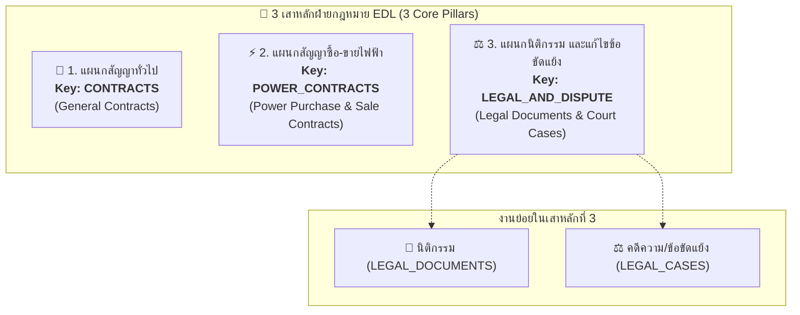

# 📘 เอกสารสรุปการเชื่อมต่อ API ทั้งระบบ (Frontend Integration Guide)

**ระบบบริหารจัดการสัญญา, นิติกรรม, คดีความ และสัญญาซื้อ-ขายไฟฟ้า (EDL Legal Management System)**  
**Version:** 2.0 (Dynamic Custom Roles, 3 Core Pillars RBAC & Stateless Token Versioning)  
**อัปเดตล่าสุด:** 03/11/2026

---

## 🌐 Environment Base URLs & Swagger Docs

| Environment | API Base URL | Swagger UI (เอกสาร & ทดสอบ API) |
| :--- | :--- | :--- |
| **UAT (Cloudflare Tunnel)** | `https://likely-ecology-refused-letters.trycloudflare.com/api` | `https://likely-ecology-refused-letters.trycloudflare.com/api/docs` |
| **Local Development** | `http://localhost:3001/api` | `http://localhost:3001/api/docs` |

> **Header มาตรฐานสำหรับทุก API ที่ต้องยืนยันตัวตน:**  
> `Authorization: Bearer <accessToken>`

---

## 1. สถาปัตยกรรม 3 เสาหลัก (3 Core Pillars) & ระบบสิทธิ์แบบ Dynamic RBAC

โครงสร้างฝ่ายกฎหมาย ໄຟຟ້າລາວ (EDL) แบ่งการทำงานออกเป็น **3 เสาหลัก (3 Core Pillars / Divisions)** พร้อมระบบกำหนดสิทธิ์แบบ Matrix 5 Actions:



### ตารางโมดูลและการเข้าถึง

| เสาหลัก (UI Pillar) | Key โมดูล | แผนกในระบบ (`division`) | โมดูลที่เกี่ยวข้องในระบบ |
| :--- | :--- | :--- | :--- |
| **1. สัญญาทั่วไป** | **`CONTRACTS`** | `ພະແນກສັນຍາທົ່ວໄປ` | `contracts`, `contract-types`, `notifications` |
| **2. สัญญาซื้อ-ขายไฟฟ้า** | **`POWER_CONTRACTS`** | `ພະແນກສັນຍາຊື້-ຂາຍໄຟຟ້າ` | `power-contracts`, `power-notifications` |
| **3. นิติกรรม และข้อขัดแย้ง** | **`LEGAL_AND_DISPUTE`** | `ພະແນກນິຕິກຳ ແລະ ແກ້ໄຂຂໍ້ຂັດແຍ່ງ` | `legal-documents`, `legal-cases` |
| **โมดูลส่วนกลาง** | `COMMON` | ทุกแผนก | `departments`, `support` |
| **ผู้ดูแลระบบ** | `ADMIN` | ทุกแผนก (`role === "ADMIN"`) | `roles`, `users`, `audit-logs` + ทุกโมดูลข้างต้น |

### Action Matrix 5 สิทธิ์ต่อโมดูล
ในแต่ละโมดูลสามารถควบคุมสิทธิ์ระดับปุ่มได้ 5 ด้าน:
- `canView`: สิทธิ์เข้าดูหน้า Dashboard, รายการ และรายละเอียด
- `canUpload`: สิทธิ์สร้างรายการใหม่ และอัปโหลดไฟล์แนบ
- `canEdit`: สิทธิ์แก้ไขข้อมูล
- `canDelete`: สิทธิ์ลบข้อมูล (Soft delete) และลบไฟล์แนบ
- `canDownload`: สิทธิ์ดาวน์โหลดไฟล์แนบ

---

## 2. ระบบยืนยันตัวตน, Pure Stateless JWT & Seamless Auto-Refresh (`/api/auth`)

ระบบใช้ **Pure Stateless JWT** โดยสิทธิ์ทั้งหมด (`permissionsByModule`, `accessibleModules`, `role`, `tokenVersion`) ถูกฝังไว้ใน Access Token ทำให้ Server ตรวจสอบสิทธิ์ได้เร็วระดับเสี้ยววินาทีโดยไม่ต้อง Query Database

### 2.1 เข้าสู่ระบบ (Login)
- **Endpoint:** `POST /api/auth/login` (หรือ `POST /api/auth/login-hrm` สำหรับพนักงานใหม่ที่ดึงข้อมูลจาก HRM)
- **Request Body:**
```json
{
  "username": "admin",
  "password": "Admin@Password123"
}
```
- **Response Data (200 OK):**
```json
{
  "accessToken": "eyJhbGciOiJIUzI1NiIsInR5cCI6IkpXVCJ9...",
  "refreshToken": "eyJhbGciOiJIUzI1NiIsInR5cCI6IkpXVCJ9...",
  "user": {
    "id": "8a8c319a-14bd-4434-a852-205c9f31af92",
    "employeeCode": "EDL-44652",
    "fullName": "ສົມສັກ ສີສຸວັນ",
    "department": "ຫ້ອງການສຳນັກງານໃຫຍ່",
    "division": "ພະແນກສັນຍາທົ່ວໄປ",
    "unit": "ໜ່ວຍງານຄຸ້ມຄອງສັນຍາ",
    "position": "ວິຊາການ",
    "phone": "02055555555",
    "role": "MAIN_USER",
    "roleId": "94029266-d1a0-4c2c-b1df-c51e8b3ea626",
    "roleTitle": "ຜູ້ໃຊ້ຫຼັກປະຈຳພະແນກ",
    "tokenVersion": 1,
    "accessibleModules": [
      "CONTRACTS",
      "CONTRACT_TYPES",
      "DEPARTMENTS",
      "SUPPORT"
    ],
    "permissionsByModule": {
      "CONTRACTS": {
        "canView": true,
        "canUpload": true,
        "canEdit": true,
        "canDelete": true,
        "canDownload": true
      },
      "POWER_CONTRACTS": {
        "canView": false,
        "canUpload": false,
        "canEdit": false,
        "canDelete": false,
        "canDownload": false
      },
      "LEGAL_AND_DISPUTE": {
        "canView": false,
        "canUpload": false,
        "canEdit": false,
        "canDelete": false,
        "canDownload": false
      },
      "LEGAL_DOCUMENTS": {
        "canView": false,
        "canUpload": false,
        "canEdit": false,
        "canDelete": false,
        "canDownload": false
      },
      "LEGAL_CASES": {
        "canView": false,
        "canUpload": false,
        "canEdit": false,
        "canDelete": false,
        "canDownload": false
      }
    }
  }
}
```

### 2.2 การดึงข้อมูลโปรไฟล์ปัจจุบัน (`GET /api/auth/me`)
- คืนค่าข้อมูลโปรไฟล์ผู้ใช้และสิทธิ์ `permissionsByModule` เหมือนกับตอน Login

### 2.3 กลไก Instant Permissions Invalidation & Seamless Auto-Refresh (`POST /api/auth/refresh`)
เมื่อ Admin มีการแก้ไขสิทธิ์ของผู้ใช้ หรือแก้ไข Role ที่ผู้ใช้นั้นผูกอยู่:
1. Backend จะปรับค่า `token_version` ของผู้ใช้นั้นขึ้นทันทีในฐานข้อมูลและ Memory Cache
2. เมื่อผู้ใช้ยิง API ถัดไป Backend จะตรวจพบว่า Token Version เก่า และตอบกลับด้วย:
   ```json
   {
     "statusCode": 401,
     "message": "Token version is outdated. Permissions or session have been updated.",
     "code": "TOKEN_OUTDATED"
   }
   ```
3. **Frontend จัดการ Seamless Auto-Refresh (ไม่ต้อง Login ใหม่):**
   - Interceptor ดักจับ `401` และตรวจสอบ `error.response?.data?.code === 'TOKEN_OUTDATED'`
   - เรียก `POST /api/auth/refresh` โดยส่ง `refreshToken` ไปขอ Token ใหม่
   - อัปเดต `accessToken` และ `permissionsByModule` ล่าสุด
   - ทำการ Replay Request เดิมของผู้ใช้ทันที โดยผู้ใช้ไม่รู้สึกสะดุดและไม่ต้องออกจากระบบ!

**Request Body (`POST /api/auth/refresh`):**
```json
{
  "refreshToken": "eyJhbGciOiJIUzI1NiIsInR5cCI6IkpXVCJ9..."
}
```

---

## 3. เสาหลักที่ 1: แผนกสัญญาทั่วไป (`contracts`, `contract-types` & `notifications`)

ติดตามสัญญา 14 ประเภทหลักของ ฟฟล พร้อมระบบแจ้งเตือนล่วงหน้า 60 วัน

### 3.1 ประเภทสัญญา 14 ประเภท (`/api/contract-types`)
- **Dropdown ตัวเลือก:** `GET /api/contract-types/dropdown`
- **รายการทั้งหมด:** `GET /api/contract-types?search=&isActive=true`
- **สร้างประเภทใหม่:** `POST /api/contract-types` `{ "nameLo": "...", "nameEn": "..." }`
- **แก้ไข/ลบ:** `PATCH /api/contract-types/:id`, `DELETE /api/contract-types/:id`

### 3.2 การจัดการสัญญา (`/api/contracts`)
| การทำงาน | Method & Endpoint | รายละเอียด / Query |
| :--- | :--- | :--- |
| **Dashboard สัญญา** | `GET /api/contracts/dashboard` | คืนสรุปสัญญาทั้งหมด, ใกล้หมดอายุ, หมดอายุ, แยกตามสถานะ, สกุลเงิน, ประเภทสัญญา |
| **รายการสัญญา** | `GET /api/contracts` | Query: `page`, `limit`, `search`, `status`, `contractTypeId` |
| **รายละเอียดสัญญา** | `GET /api/contracts/:id` | คืนข้อมูลสัญญา + `contractType` + `attachments` + `auditLogs` |
| **ประวัติการแก้ไข** | `GET /api/contracts/:id/history` | Query: `page`, `limit`, `action` |
| **สร้างสัญญาใหม่** | `POST /api/contracts` | ดู Payload ด้านล่าง |
| **แก้ไขสัญญา** | `PATCH /api/contracts/:id` | ส่งเฉพาะฟิลด์ที่ต้องการแก้ไข |
| **ลบสัญญา** | `DELETE /api/contracts/:id` | Soft delete |

**Payload สร้างสัญญา (`POST /api/contracts`):**
```json
{
  "title": "ສັນຍາຈ້າງເໝົາບຳລຸງຮັກສາ (O&M)",
  "contractTypeId": 1,
  "contractNumber": "EDL-CON-2026/001",
  "durationText": "5 ປີ",
  "durationMonths": 60,
  "signedDate": "2026-01-10",
  "effectiveDate": "2026-02-01",
  "expirationDate": "2031-02-01",
  "contractValue": 1500000,
  "currency": "USD",
  "equityOrCapitalContribution": "51%",
  "sharePercentage": 51.0,
  "implementer": "ຝ່າຍວິສະວະກຳ",
  "additionalDetails": "ໝາຍເຫດເພີ່ມເຕີມ",
  "notifyDaysBefore": 60
}
```
- **Enums:**
  - `currency`: `LAK`, `USD`, `CNY`
  - `status`: `DRAFT`, `ACTIVE`, `EXPIRING_SOON`, `EXPIRED`, `TERMINATED`

### 3.3 แจ้งเตือนสัญญาใกล้หมดอายุ 60 วัน (`/api/notifications`)
- `GET /api/notifications?unreadOnly=true` (คืน `unreadCount`, `total`, `data`)
- `PATCH /api/notifications/:id/read`
- `PATCH /api/notifications/read-all`
- `POST /api/notifications/trigger-check` (Trigger สแกนสัญญาใกล้หมดอายุและสร้างแจ้งเตือนทันที สำหรับทดสอบไม่ต้องรอเที่ยงคืน)

---

## 4. เสาหลักที่ 2: แผนกสัญญาซื้อ-ขายไฟฟ้า (`power-contracts` & `power-notifications`)

จัดเก็บสัญญาซื้อไฟฟ้า (PPA) และสัญญาขายไฟฟ้า (PSA) ติดตามกำลังการติดตั้ง (MW) และแจ้งเตือนหมดอายุ

### 4.1 UI Conditional Logic ในฟอร์ม
- เมื่อเลือก `contractType === "PURCHASE"` (**ສັນຍາຊື້ໄຟຟ້າ**):
  - ช่อง `projectTypeOrCustomer` ให้แสดงเป็น **Dropdown 5 ประเภทโครงการ** ดึงจาก `GET /api/power-contracts/project-types`:
    - `ໄຟຟ້ານໍ້າຕົກ` (Hydro)
    - `ພະລັງງານແສງຕາເວັນ` (Solar)
    - `ພະລັງງານລົມ` (Wind)
    - `ພະລັງງານຄວາມຮ້ອນ / ຖ່ານຫີນ` (Thermal/Coal)
    - `ພະລັງງານຊີວະມວນ` (Biomass)
- เมื่อเลือก `contractType === "SALE"` (**ສັນຍາຂາຍໄຟຟ້າ**):
  - ช่อง `projectTypeOrCustomer` ให้แสดงเป็น **Text Input** สำหรับกรอกชื่อลูกค้า/โครงการ

### 4.2 การจัดการสัญญาซื้อ-ขายไฟฟ้า (`/api/power-contracts`)
| การทำงาน | Method & Endpoint | รายละเอียด / Query |
| :--- | :--- | :--- |
| **Dashboard สัญญาซื้อ-ขายไฟ** | `GET /api/power-contracts/dashboard` | คืนยอดรวม, แยกสถานะ, แยก PPA/PSA, กำลังติดตั้งรวม (MW), กราฟประเภทโครงการ |
| **Dropdown 5 ประเภทโครงการ** | `GET /api/power-contracts/project-types` | รายการ 5 ประเภทโครงการสำหรับ PPA |
| **รายการสัญญา** | `GET /api/power-contracts` | Query: `page`, `limit`, `search`, `contractType` (`PURCHASE`/`SALE`), `status` |
| **รายละเอียดสัญญา** | `GET /api/power-contracts/:id` | คืนข้อมูลสัญญา + `attachments` + `auditLogs` |
| **ประวัติการแก้ไข** | `GET /api/power-contracts/:id/history` | Query: `page`, `limit` |
| **สร้างสัญญาใหม่** | `POST /api/power-contracts` | ดู Payload ด้านล่าง |
| **แก้ไขสัญญา** | `PATCH /api/power-contracts/:id` | ส่งเฉพาะฟิลด์ที่ต้องการแก้ไข |
| **ลบสัญญา** | `DELETE /api/power-contracts/:id` | Soft delete |

**Payload สร้างสัญญาซื้อ-ขายไฟฟ้า (`POST /api/power-contracts`):**
```json
{
  "contractType": "PURCHASE",
  "contractNumber": "PPA-2026-001",
  "projectName": "ໂຄງການເຂື່ອນໄຟຟ້ານ້ຳອູ 1",
  "projectTypeOrCustomer": "ໄຟຟ້ານໍ້າຕົກ",
  "durationText": "25 ປີ",
  "durationMonths": 300,
  "signedDate": "2026-01-15",
  "effectiveDate": "2026-02-01",
  "expirationDate": "2051-02-01",
  "installedCapacity": "50 MW",
  "capacityValue": 50.0,
  "capacityUnit": "MW",
  "projectLocation": "ແຂວງຜົ້ງສາລີ",
  "tariff": "0.065 USD/kWh",
  "tariffValue": 0.065,
  "tariffCurrency": "USD",
  "additionalDetails": "ໄລຍະກໍ່ສ້າງ 3 ປີ",
  "notifyDaysBefore": 60
}
```

### 4.3 แจ้งเตือนสัญญาไฟฟ้าใกล้หมดอายุ (`/api/power-notifications`)
- `GET /api/power-notifications?unreadOnly=true` (คืน `unreadCount`, `total`, `data`)
- `PATCH /api/power-notifications/:id/read`
- `PATCH /api/power-notifications/read-all`
- `POST /api/power-notifications/trigger-check` (Trigger สแกนสัญญาไฟฟ้าใกล้หมดอายุและสร้างแจ้งเตือนทันที สำหรับทดสอบไม่ต้องรอเที่ยงคืน)

---

## 5. เสาหลักที่ 3: แผนกนิติกรรม และแก้ไขข้อขัดแย้ง (`legal-documents` & `legal-cases`)

### 5.1 ระบบงานนิติกรรม (`/api/legal-documents`)
| การทำงาน | Method & Endpoint | รายละเอียด |
| :--- | :--- | :--- |
| **Dashboard นิติกรรม** | `GET /api/legal-documents/dashboard` | สรุปยอดรวม, Active/Inactive, แยกตามประเภท (`byType`), แยกตามฝ่าย (`byDepartment`) |
| **รายการนิติกรรม** | `GET /api/legal-documents` | Query: `page`, `limit`, `search`, `docType`, `status`, `issueYear`, `departmentId` |
| **รายละเอียดนิติกรรม** | `GET /api/legal-documents/:id` | คืนข้อมูลนิติกรรม + `department` + `attachments` |
| **สร้างนิติกรรม** | `POST /api/legal-documents` | ดู Payload ด้านล่าง |
| **แก้ไขนิติกรรม** | `PATCH /api/legal-documents/:id` | ส่งเฉพาะฟิลด์ที่แก้ไข |
| **ลบนิติกรรม** | `DELETE /api/legal-documents/:id` | Soft delete |

**Payload สร้างนิติกรรม (`POST /api/legal-documents`):**
```json
{
  "docTitle": "ກົດລະບຽບວ່າດ້ວຍການຄຸ້ມຄອງພະນັກງານ",
  "docType": "REGULATION",
  "issueYear": 2026,
  "docNumberDate": "ເລກທີ 012/ຟຟລ, ລົງວັນທີ 15/01/2026",
  "status": "ACTIVE",
  "responsiblePerson": "ທ່ານ ສົມສັກ ວົງສາ",
  "departmentId": "uuid-ของฝ่ายจาก-api-departments-dropdown",
  "purpose": "ເພື່ອກຳນົດຫຼັກການ ແລະ ລະບຽບການ...",
  "externalUrl": "https://sharepoint.edl.com.la/docs/123"
}
```
- `docType`: `REGULATION`, `PROVISION`, `AGREEMENT`, `NOTIFICATION`, `INSTRUCTION`, `PROPOSAL`, `CONTRACT`, `MANUAL`, `OTHER`
- `status`: `ACTIVE`, `INACTIVE`

### 5.2 ระบบงานคดีความและข้อขัดแย้ง (`/api/legal-cases`)
| การทำงาน | Method & Endpoint | รายละเอียด |
| :--- | :--- | :--- |
| **Dashboard คดีความ** | `GET /api/legal-cases/dashboard` | คดีรวม, สถานะศาล 3 ขั้น, ยอดการเงิน LAK และ USD (ความเสียหาย, ค่าปรับ, ยอดต้องชำระ, ยอดกู้คืนได้) |
| **รายการคดีความ** | `GET /api/legal-cases` | Query: `page`, `limit`, `search`, `caseType`, `disputeStatus`, `departmentId` |
| **รายละเอียดคดีความ** | `GET /api/legal-cases/:id` | ใช้ UUID คืนข้อมูลคดี + `department` + `attachments` |
| **สร้างคดีความ** | `POST /api/legal-cases` | คำนวณ `totalDueLak/totalDueUsd` อัตโนมัติ |
| **แก้ไขคดีความ** | `PATCH /api/legal-cases/:id` | ส่งเฉพาะฟิลด์ที่แก้ไข |
| **ลบคดีความ** | `DELETE /api/legal-cases/:id` | Soft delete |

**Payload สร้างคดีความ (`POST /api/legal-cases`):**
```json
{
  "caseCode": "EDL-2026-005",
  "defendant": "ບໍລິສັດ ບົວລະພາ ກໍ່ສ້າງ ຈຳກັດ",
  "allegation": "ລະເມີດສັນຍາຮັບເໝົາກໍ່ສ້າງ",
  "departmentId": "uuid-ของฝ่ายที่เกี่ยวข้อง",
  "departmentAction": "ສົ່ງເອກະສານໃຫ້ພະແນກນິຕິກຳດຳເນີນຄະດີ",
  "caseType": "COMMERCIAL",
  "damageLak": 500000000,
  "damageUsd": 25000,
  "fineLak": 50000000,
  "fineUsd": 2500,
  "disputeStatus": "FIRST_INSTANCE",
  "recoveredLak": 100000000,
  "recoveredUsd": 5000,
  "date": "2026-01-15",
  "disputeProgress": "ສານຂັ້ນຕົ້ນກຳລັງໄຕ່ສວນພະຍານ",
  "externalUrl": "https://sharepoint.edl.com.la/cases/005"
}
```
- `caseType`: `COMMERCIAL`, `CIVIL`, `CRIMINAL`, `ADMINISTRATIVE`, `OTHER`
- `disputeStatus`: `FIRST_INSTANCE`, `APPEAL`, `SUPREME`, `CLOSED`, `RESOLVED`

---

## 6. มาตรฐานการจัดการไฟล์แนบ (เหมือนกันทุกระบบ)

ทุกระบบงาน (`contracts`, `power-contracts`, `legal-documents`, `legal-cases`) ใช้โครงสร้างจัดการไฟล์แนบเหมือนกัน:

`<module-path>` ได้แก่:
1. `contracts`
2. `power-contracts`
3. `legal-documents`
4. `legal-cases`

| การทำงาน | Method & Endpoint | รายละเอียด |
| :--- | :--- | :--- |
| **1. ดึงไฟล์แนบ** | `GET /api/<module-path>/:id/attachments` | ดึงรายการไฟล์ทั้งหมด |
| **2. อัปโหลดไฟล์** | `POST /api/<module-path>/:id/attachments` | `multipart/form-data` ชื่อฟิลด์ `file` (PDF, PNG, JPG, JPEG, WEBP ไม่เกิน 25MB) |
| **3. ดูไฟล์ Inline (Preview)** | `GET /api/<module-path>/attachments/:attachmentId/preview` | แสดงบน Browser (รองรับ `?token=<JWT>` ใน `<iframe>` หรือ ``) |
| **4. ดาวน์โหลดไฟล์** | `GET /api/<module-path>/attachments/:attachmentId/download` | ดาวน์โหลดไฟล์ (รองรับ `?token=<JWT>`) |
| **5. ลบไฟล์แนบ** | `DELETE /api/<module-path>/attachments/:attachmentId` | Soft delete |

---

## 7. ระบบจัดการบทบาท (Roles Management: `/api/roles` - Admin Only)

Admin สามารถสร้าง Role ใหม่ และกำหนดสิทธิ์ Matrix 3 เสาหลักได้อย่างอิสระ:

| การทำงาน | Method & Endpoint | รายละเอียด |
| :--- | :--- | :--- |
| **ดึงรายการ Role ทั้งหมด** | `GET /api/roles` | คืนรายการ Role ทั้งหมดพร้อมสิทธิ์ Matrix และจำนวนผู้ใช้ที่ผูกอยู่ |
| **ดึงข้อมูล Role ตาม ID** | `GET /api/roles/:id` | คืนรายละเอียดและ Permissions รายโมดูล |
| **สร้าง Role ใหม่** | `POST /api/roles` | ดู Payload ด้านล่าง |
| **แก้ไข Role & Permissions** | `PATCH /api/roles/:id` | แก้ไขชื่อ คำอธิบาย หรือสิทธิ์ Matrix |
| **ลบ Role** | `DELETE /api/roles/:id` | ไม่อนุญาตให้ลบ System Role หรือ Role ที่มีผู้ใช้อยู่ |

**Payload สร้างบทบาทใหม่ (`POST /api/roles`):**
```json
{
  "name": "POWER_AUDITOR",
  "title": "ຜູ້ກວດສອບສັນຍາໄຟຟ້າ",
  "description": "ກວດສອບ ແລະ ດາວໂຫຼດເອກະສານສັນຍາຊື້-ຂາຍໄຟຟ້າທັງໝົດ",
  "permissions": [
    {
      "module": "POWER_CONTRACTS",
      "canView": true,
      "canUpload": false,
      "canEdit": false,
      "canDelete": false,
      "canDownload": true
    },
    {
      "module": "CONTRACTS",
      "canView": true,
      "canUpload": false,
      "canEdit": false,
      "canDelete": false,
      "canDownload": false
    }
  ]
}
```

---

## 8. ระบบจัดการผู้ใช้งาน (Users Management: `/api/users` - Admin Only)

| การทำงาน | Method & Endpoint | รายละเอียด |
| :--- | :--- | :--- |
| **ค้นหาข้อมูลจาก HRM (Auto-fill)** | `GET /api/users/hrm/:empCode` | ค้นหาชื่อ แผนก ตำแหน่ง อีเมล เบอร์โทรจากระบบ HRM เพื่อกรอกฟอร์มอัตโนมัติ |
| **ดึงรายชื่อผู้ใช้** | `GET /api/users` | Query: `page`, `limit`, `search`, `role`, `isActive` |
| **ดึงข้อมูลผู้ใช้ตาม ID** | `GET /api/users/:id` | คืนโปรไฟล์, Role, และ Module Permissions |
| **สร้างผู้ใช้ใหม่** | `POST /api/users` | ดู Payload ด้านล่าง |
| **แก้ไขผู้ใช้และสิทธิ์** | `PATCH /api/users/:id` | แก้ไข Role, แผนก หรือปรับแต่ง Module Permissions เฉพาะบุคคล |
| **รีเซ็ตรหัสผ่านผู้ใช้** | `PATCH /api/users/:id/reset-password` | Admin ตั้งรหัสผ่านใหม่ให้ผู้ใช้ |
| **เปลี่ยนรหัสผ่านตนเอง** | `PATCH /api/users/change-password` | ผู้ใช้ทั่วไปเปลี่ยนรหัสผ่าน `{ "oldPassword": "...", "newPassword": "..." }` |
| **ลบบัญชีผู้ใช้** | `DELETE /api/users/:id` | Soft delete |

**Payload สร้างผู้ใช้ใหม่ (`POST /api/users`):**
```json
{
  "employeeCode": "EDL-44652",
  "role": "MAIN_USER",
  "roleId": "94029266-d1a0-4c2c-b1df-c51e8b3ea626",
  "division": "ພະແນກສັນຍາທົ່ວໄປ",
  "modulePermissions": [
    {
      "module": "CONTRACTS",
      "canView": true,
      "canUpload": true,
      "canEdit": true,
      "canDelete": true,
      "canDownload": true
    },
    {
      "module": "POWER_CONTRACTS",
      "canView": false,
      "canUpload": false,
      "canEdit": false,
      "canDelete": false,
      "canDownload": false
    },
    {
      "module": "LEGAL_AND_DISPUTE",
      "canView": false,
      "canUpload": false,
      "canEdit": false,
      "canDelete": false,
      "canDownload": false
    }
  ]
}
```

---

## 9. ข้อมูลส่วนกลาง (Departments, Support & Audit Logs)

### 9.1 ข้อมูลห้องการ/ฝ่ายของ ฟฟล (`/api/departments`)
- **Dropdown รายชื่อฝ่าย:** `GET /api/departments/dropdown`
- **Sync จาก HRM:** `POST /api/departments/sync`
- **CRUD:** `GET /api/departments`, `POST /api/departments`, `PATCH /api/departments/:id`, `DELETE /api/departments/:id`

### 9.2 ติดต่อทีมสนับสนุน & แจ้งปัญหา (`/api/support`)
- **ช่องทางติดต่อ IT Support:** `GET /api/support/contacts`
- **ส่ง Ticket แจ้งปัญหา:** `POST /api/support/tickets` (`multipart/form-data`: `subject`, `description`, `priority`, แนบไฟล์ภาพ `file` ได้)
- **ดูรายการ Ticket:** `GET /api/support/tickets`
- **อัปเดตสถานะ Ticket:** `PATCH /api/support/tickets/:id`

### 9.3 ประวัติการดำเนินงาน (Audit Logs: `/api/audit-logs` - Admin Only)
- **ดึงรายการ Audit Logs:** `GET /api/audit-logs?page=1&limit=20&action=CREATE_CONTRACT`

---

## 10. ตัวอย่างโค้ด Axios Interceptor สำหรับ Frontend (Seamless Auto-Refresh)

เพื่อให้ Frontend รองรับการต่ออายุ Token อัตโนมัติเมื่อสิทธิ์ถูกเปลี่ยน โดยผู้ใช้ไม่หลุดออกจากระบบ:

```typescript
import axios from 'axios';

const api = axios.create({
  baseURL: process.env.NEXT_PUBLIC_API_URL || 'http://localhost:3001/api',
});

// 1. Request Interceptor: แนบ Access Token
api.interceptors.request.use((config) => {
  const token = localStorage.getItem('accessToken');
  if (token) {
    config.headers.Authorization = `Bearer ${token}`;
  }
  return config;
});

// 2. Response Interceptor: ดักจับ 401 TOKEN_OUTDATED
let isRefreshing = false;
let failedQueue: Array<{
  resolve: (value?: unknown) => void;
  reject: (reason?: unknown) => void;
}> = [];

const processQueue = (error: any, token: string | null = null) => {
  failedQueue.forEach((prom) => {
    if (error) {
      prom.reject(error);
    } else {
      prom.resolve(token);
    }
  });
  failedQueue = [];
};

api.interceptors.response.use(
  (response) => response,
  async (error) => {
    const originalRequest = error.config;

    // ตรวจสอบเงื่อนไข 401 และ Token Outdated
    if (
      error.response?.status === 401 &&
      error.response?.data?.code === 'TOKEN_OUTDATED' &&
      !originalRequest._retry
    ) {
      if (isRefreshing) {
        return new Promise((resolve, reject) => {
          failedQueue.push({ resolve, reject });
        })
          .then((token) => {
            originalRequest.headers.Authorization = `Bearer ${token}`;
            return api(originalRequest);
          })
          .catch((err) => Promise.reject(err));
      }

      originalRequest._retry = true;
      isRefreshing = true;

      try {
        const refreshToken = localStorage.getItem('refreshToken');
        if (!refreshToken) throw new Error('No refresh token available');

        // ยิงขอ Token ใหม่พร้อมสิทธิ์ล่าสุด
        const res = await axios.post(`${api.defaults.baseURL}/auth/refresh`, {
          refreshToken,
        });

        const { accessToken, refreshToken: newRefreshToken, user } = res.data;

        localStorage.setItem('accessToken', accessToken);
        localStorage.setItem('refreshToken', newRefreshToken);
        if (user) {
          localStorage.setItem('user', JSON.stringify(user));
        }

        api.defaults.headers.common['Authorization'] = `Bearer ${accessToken}`;
        originalRequest.headers['Authorization'] = `Bearer ${accessToken}`;

        processQueue(null, accessToken);
        return api(originalRequest);
      } catch (refreshErr) {
        processQueue(refreshErr, null);
        // Refresh Token หมดอายุจริง ๆ ค่อยส่งไปหน้า Login
        localStorage.clear();
        window.location.href = '/login';
        return Promise.reject(refreshErr);
      } finally {
        isRefreshing = false;
      }
    }

    return Promise.reject(error);
  }
);

export default api;
```
