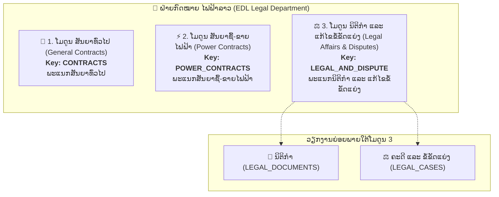

# ຄູ່ມືການປັບປຸງ ແລະ ເຊື່ອມຕໍ່ລະບົບກຳນົດສິດໃໝ່ສຳລັບທີມ Frontend
## Frontend Integration Guide: Dynamic RBAC & 3 Core Modules Permission Matrix

> **ລະບົບ:** Legal Contract Management System (EDL - ຟຟລ)  
> **ເວີຊັນ:** 2.0 (Dynamic Custom Roles & 3 Core Modules RBAC)  
> **ວັນທີປັບປຸງ:** 02/11/2026  
> **ສະຖານະ Backend:** ພ້ອມໃຊ້ງານ (Deployed & Verified 100%)

---

## 📑 ສາລະບານ (Table of Contents)
1. [ພາບລວມສະຖາປັດຕະຍະກຳ 3 ໂມດູນຫຼັກ (3 Core Modules Architecture)](#1-ພາບລວມສະຖາປັດຕະຍະກຳ-3-ໂມດູນຫຼັກ-3-core-modules-architecture)
2. [ໂຄງສ້າງ Auth / Login Response ໃໝ່](#2-ໂຄງສ້າງ-auth--login-response-ໃໝ່)
3. [ຕາຕະລາງ 3 ໂມດູນຫຼັກ ແລະ Action Matrix](#3-ຕາຕະລາງ-3-ໂມດູນຫຼັກ-ແລະ-action-matrix)
4. [ການປັບປຸງ Sidebar, Navigation & Route Guard](#4-ການປັບປຸງ-sidebar-navigation--route-guard)
5. [ການຄວບຄຸມປຸ່ມ Action (Button-Level Permissions)](#5-ການຄວບຄຸມປຸ່ມ-action-button-level-permissions)
6. [ໜ້າໃໝ່: ການຈັດການບົດບາດ (Roles Management UI: `/roles`)](#6-ໜ້າໃໝ່-ການຈັດການບົດບາດ-roles-management-ui-roles)
7. [ການປັບປຸງໜ້າຈັດການຜູ້ໃຊ້ (User Management UI: `/users`)](#7-ການປັບປຸງໜ້າຈັດການຜູ້ໃຊ້-user-management-ui-users)
8. [ຕົວຢ່າງ TypeScript Interfaces & Code Examples](#8-ຕົວຢ່າງ-typescript-interfaces--code-examples)
9. [ການຈັດການ Error Codes ຈາກ Backend](#9-ການຈັດການ-error-codes-ຈາກ-backend)

---

## 1. ພາບລວມສະຖາປັດຕະຍະກຳ 3 ໂມດູນຫຼັກ (3 Core Modules Architecture)

ລະບົບຄຸ້ມຄອງວຽກງານກົດໝາຍຂອງ ໄຟຟ້າລາວ (EDL) ຖືກຈັດແບ່ງຕາມ **3 ພະແນກຫຼັກ (3 Core Modules / Pillars)** ຢ່າງຈະແຈ້ງ:



| # | ໂມດູນຫຼັກ (UI Pillar) | Key ໂມດູນ | ພະແນກຕົ້ນສັງກັດ | ວຽກງານທີ່ຮັບຜິດຊອບ |
| :- | :--- | :--- | :--- | :--- |
| **1** | **ສັນຍາທົ່ວໄປ** | **`CONTRACTS`** | ພະແນກສັນຍາທົ່ວໄປ | ສັນຍາ 14 ປະເພດ, ແຈ້ງເຕືອນສັນຍາໃກ້ໝົດອາຍຸ (60 ວັນ), ມູນຄ່າ 3 ສະກຸນເງິນ, ໄຟລ໌ແນບ |
| **2** | **ສັນຍາຊື້-ຂາຍໄຟຟ້າ** | **`POWER_CONTRACTS`** | ພະແນກສັນຍາຊື້-ຂາຍໄຟຟ້າ | ສັນຍາ PPA / PSA, ໂຄງການໄຟຟ້າ 5 ປະເພດ, MW/kW, Tariff, ແຈ້ງເຕືອນໝົດອາຍຸ |
| **3** | **ນິຕິກຳ ແລະ ແກ້ໄຂຂໍ້ຂັດແຍ່ງ** | **`LEGAL_AND_DISPUTE`** | ພະແນກນິຕິກຳ ແລະ ແກ້ໄຂຂໍ້ຂັດແຍ່ງ | ຄຸ້ມຄອງທັງ 2 ວຽກງານ: **ນິຕິກຳ** (`LEGAL_DOCUMENTS`) ແລະ **ສຳນວນຄະດີ/ຂໍ້ຂັດແຍ່ງ** (`LEGAL_CASES`) |

> [!NOTE]
> **ຈຸດສຳຄັນສຳລັບ UI / UX ຝັ່ງ Frontend:**
> ໃນຕາຕະລາງກຳນົດສິດ (Permission Matrix) ທັງໃນໜ້າ **ຈັດການບົດບາດ (`/roles`)** ແລະ **ຈັດການຜູ້ໃຊ້ (`/users`)**, Frontend ຈະສະແດງພຽງ **3 ແຖວ (3 ໂມດູນຫຼັກ)** ເທົ່ານັ້ນ ເພື່ອໃຫ້ຜູ້ໃຊ້ງານ ແລະ Admin ເຂົ້າໃຈງ່າຍ ບໍ່ສັບສົນ. ເມື່ອຕິກເລືອກສິດໃນແຖວທີ 3 (`LEGAL_AND_DISPUTE`), ລະບົບຈະຄຸມສິດທັງວຽກງານນິຕິກຳ ແລະ ວຽກງານຄະດີຄວາມພ້ອມກັນໂດຍອັດຕະໂນມັດ!

---

## 2. ໂຄງສ້າງ Auth / Login Response ໃໝ່

ທັງ Endpoint **`POST /api/auth/login`** (Local Login) ແລະ **`POST /api/auth/login-hrm`** (HRM Sync Login) ຈະສົ່ງຂໍ້ມູນສິດທີ່ຄຳນວນແລ້ວຄືນມາໃນ Object `user`:

### Response Payload ຕົວຢ່າງ:
```json
{
  "accessToken": "eyJhbGciOiJIUzI1NiIsInR5cCI6IkpXVCJ9...",
  "refreshToken": "eyJhbGciOiJIUzI1NiIsInR5cCI6IkpXVCJ9...",
  "user": {
    "id": "1d6580b1-781a-45a6-83ac-203f66c3c04a",
    "employeeCode": "EDL-44652",
    "fullName": "ສົມສັກ ສີສຸວັນ",
    "department": "ຫ້ອງການສຳນັກງານໃຫຍ່",
    "division": "ພະແນກສັນຍາທົ່ວໄປ",
    "unit": "ໜ່ວຍງານຄຸ້ມຄອງສັນຍາ",
    "position": "ວິຊາການ",
    "phone": "02055555555",
    "role": "MAIN_USER",
    "roleId": "94029266-d1a0-4c2c-b1df-c51e8b3ea626",
    "roleTitle": "ຜູ້ໃຊ້ຫຼັກປະຈຳພະແນກ",
    "accessibleModules": [
      "CONTRACTS",
      "CONTRACT_TYPES",
      "DEPARTMENTS",
      "SUPPORT"
    ],
    "permissionsByModule": {
      "CONTRACTS": {
        "canView": true,
        "canUpload": true,
        "canEdit": true,
        "canDelete": true,
        "canDownload": true
      },
      "POWER_CONTRACTS": {
        "canView": false,
        "canUpload": false,
        "canEdit": false,
        "canDelete": false,
        "canDownload": false
      },
      "LEGAL_AND_DISPUTE": {
        "canView": false,
        "canUpload": false,
        "canEdit": false,
        "canDelete": false,
        "canDownload": false
      },
      "LEGAL_DOCUMENTS": {
        "canView": false,
        "canUpload": false,
        "canEdit": false,
        "canDelete": false,
        "canDownload": false
      },
      "LEGAL_CASES": {
        "canView": false,
        "canUpload": false,
        "canEdit": false,
        "canDelete": false,
        "canDownload": false
      }
    }
  }
}
```

### 2.1 ກົນໄກ Auto-Refresh ເມື່ອສິດຖືກປ່ຽນກາງຄັນ (Instant Permissions Invalidation & Seamless Refresh)

ລະບົບໄດ້ອອກແບບຕາມຫຼັກການ **Pure Stateless JWT + Token Versioning**:
1. **ສິດທິທັງໝົດຖືກບັນຈຸໄວ້ໃນ `accessToken`:** ເຮັດໃຫ້ Backend Guard ກວດສອບສິດໄດ້ໄວລະດັບ Nanosecond (0 Database Queries).
2. **ເມື່ອ Admin ມີການແກ້ໄຂສິດ (Role ຫຼື User Permissions):**
   - Backend ຈະເຮັດການ Increment `tokenVersion` ທັນທີ.
   - `accessToken` ເກົ່າຂອງ User ຈະໝົດອາຍຸທັນທີ! (Invalidated ທັນທີໂດຍບໍ່ຕ້ອງລໍຖ້າໃຫ້ເວລາ 8 ຊົ່ວໂມງໝົດ).
   - Request ຖັດໄປທີ່ User ຍິງເຂົ້າມາ Backend ຈະຕອບກັບດ້ວຍ: `401 Unauthorized` ພ້ອມ `code: "TOKEN_OUTDATED"`.
3. **Frontend Axios Interceptor ຈັດການ Auto-Refresh ແບບ Seamless:**
   - ເມື່ອເຈີ `401 TOKEN_OUTDATED`, Frontend ຈະ **ບໍ່ເຕະ User ອອກໄປໜ້າ Login**.
   - Interceptor ຈະດັກຈັບແລ້ວເອີ້ນ **`POST /api/auth/refresh`** ໂດຍອັດຕະໂນມັດ ໂດຍສົ່ງ `refreshToken` ທີ່ເກັບໄວ້ໄປຂໍ Access Token ໃໝ່.
   - Backend ຈະອອກ `accessToken` ໃໝ່ທີ່ບັນຈຸ **ສິດທິໃໝ່ລ່າສຸດ** ກັບຄືນມາ.
   - Frontend ຈະນຳ Token ໃໝ່ໄປ Replay Request ເດີມໃຫ້ສຳເລັດ.
   - **User ຈະເຫັນສິດໃໝ່ມີຜົນທັນທີ ໂດຍບໍ່ຮູ້ສຶກເຖິງການສະດຸດ ຫຼື ຕ້ອງ Login ໃໝ່ເລີຍ!**

> [!TIP]
> Backend ໄດ້ສົ່ງຄ່າ **`LEGAL_AND_DISPUTE`** ມາໃຫ້ໂດຍກົງໃນ `permissionsByModule` ພ້ອມກັບ `LEGAL_DOCUMENTS` ແລະ `LEGAL_CASES`. Frontend ສາມາດເລືອກໃຊ້ key `LEGAL_AND_DISPUTE` ສຳລັບຈັດການ 3 ໂມດູນໄດ້ທັນທີ!

---

## 3. ຕາຕະລາງ 3 ໂມດູນຫຼັກ ແລະ Action Matrix

ແຕ່ລະໂມດູນຫຼັກຈະມີ 5 Actions ທີ່ຄວບຄຸມ:

| # | ໂມດູນ (Pillar) | Key ໂມດູນ | Path URL ຫຼັກ | Actions ທີ່ຮອງຮັບ |
| :- | :--- | :--- | :--- | :--- |
| **1** | **ສັນຍາທົ່ວໄປ** | `CONTRACTS` | `/contracts` | `canView`, `canUpload`, `canEdit`, `canDelete`, `canDownload` |
| **2** | **ສັນຍາຊື້-ຂາຍໄຟຟ້າ** | `POWER_CONTRACTS` | `/power-contracts` | `canView`, `canUpload`, `canEdit`, `canDelete`, `canDownload` |
| **3** | **ນິຕິກຳ ແລະ ແກ້ໄຂຂໍ້ຂັດແຍ່ງ** | `LEGAL_AND_DISPUTE` | `/legal-documents`<br/>`/legal-cases` | `canView`, `canUpload`, `canEdit`, `canDelete`, `canDownload` |

### ຄວາມໝາຍຂອງແຕ່ລະ Action:
* **`canView`**: ສິດເຂົ້າເບິ່ງໜ້າ Dashboard, ລາຍການຕາຕະລາງ ແລະ ລາຍລະອຽດ
* **`canUpload`**: ສິດກົດປຸ່ມສ້າງໃໝ່, ອັບໂຫຼດໄຟລ໌ແນບ
* **`canEdit`**: ສິດກົດປຸ່ມແກ້ໄຂຂໍ້ມູນ
* **`canDelete`**: ສິດກົດປຸ່ມລົບຂໍ້ມູນ (Soft delete) ຫຼື ລົບໄຟລ໌ແນບ
* **`canDownload`**: ສິດກົດປຸ່ມດາວໂຫຼດໄຟລ໌ເອກະສານແນບ

---

## 4. ການປັບປຸງ Sidebar, Navigation & Route Guard

### 4.1 Sidebar Visibility (ການສະແດງເມນູຂ້າງ)
Frontend ສາມາດກວດສອບສິດເປີດ/ປິດກຸ່ມເມນູ 3 ພະແນກໄດ້ງ່າຍໆ:

```typescript
// 1. ໂມດູນສັນຍາທົ່ວໄປ
const canSeeContracts = user.permissionsByModule?.CONTRACTS?.canView;

// 2. ໂມດູນສັນຍາຊື້-ຂາຍໄຟຟ້າ
const canSeePowerContracts = user.permissionsByModule?.POWER_CONTRACTS?.canView;

// 3. ໂມດູນນິຕິກຳ ແລະ ແກ້ໄຂຂໍ້ຂັດແຍ່ງ (ກວດສອບຜ່ານ LEGAL_AND_DISPUTE ໄດ້ເລີຍ)
const canSeeLegalAndDispute = user.permissionsByModule?.LEGAL_AND_DISPUTE?.canView;

// ເມນູ Admin Only (ຈັດການລະບົບ)
const isAdmin = user.role === 'ADMIN';
```

### 4.2 Route Guard ຝັ່ງ Frontend
ຫາກ User ພະຍາຍາມພິມ URL ເຂົ້າໜ້າທີ່ຕົນເອງບໍ່ມີສິດ `canView` ໃຫ້ Redirect ໄປໜ້າ 403 ຫຼື Dashboard:

```typescript
// Next.js Middleware ຫຼື React / Vue Navigation Guard
const modulePathMap: Record<string, string> = {
  '/contracts': 'CONTRACTS',
  '/power-contracts': 'POWER_CONTRACTS',
  '/legal-documents': 'LEGAL_AND_DISPUTE',
  '/legal-cases': 'LEGAL_AND_DISPUTE',
};

export function checkPageAccess(pathname: string, user: UserProfile): boolean {
  if (user.role === 'ADMIN') return true;
  
  const matchedPrefix = Object.keys(modulePathMap).find(prefix => pathname.startsWith(prefix));
  if (!matchedPrefix) return true; // ໜ້າທົ່ວໄປ (Dashboard, Profile, Support)

  const targetModule = modulePathMap[matchedPrefix];
  return Boolean(user.permissionsByModule?.[targetModule]?.canView);
}
```

---

## 5. ການຄວບຄຸມປຸ່ມ Action (Button-Level Permissions)

### 5.1 ໂມດູນ ສັນຍາທົ່ວໄປ (`CONTRACTS`)
* **ປຸ່ມ "ສ້າງສັນຍາໃໝ່"** / **"ອັບໂຫຼດໄຟລ໌ແນບ"**: `user.permissionsByModule.CONTRACTS.canUpload`
* **ປຸ່ມ "ແກ້ໄຂສັນຍາ"**: `user.permissionsByModule.CONTRACTS.canEdit`
* **ປຸ່ມ "ລົບສັນຍາ"** / **"ລົບໄຟລ໌ແນບ"**: `user.permissionsByModule.CONTRACTS.canDelete`
* **ປຸ່ມ "ດາວໂຫຼດໄຟລ໌"**: `user.permissionsByModule.CONTRACTS.canDownload`

### 5.2 ໂມດູນ ສັນຍາຊື້-ຂາຍໄຟຟ້າ (`POWER_CONTRACTS`)
* **ປຸ່ມ "ສ້າງສັນຍາຊື້-ຂາຍໄຟໃໝ່"** / **"ອັບໂຫຼດ"**: `user.permissionsByModule.POWER_CONTRACTS.canUpload`
* **ປຸ່ມ "ແກ້ໄຂສັນຍາ"**: `user.permissionsByModule.POWER_CONTRACTS.canEdit`
* **ປຸ່ມ "ລົບສັນຍາ"** / **"ລົບໄຟລ໌ແນບ"**: `user.permissionsByModule.POWER_CONTRACTS.canDelete`
* **ປຸ່ມ "ດາວໂຫຼດໄຟລ໌"**: `user.permissionsByModule.POWER_CONTRACTS.canDownload`

### 5.3 ໂມດູນ ນິຕິກຳ ແລະ ແກ້ໄຂຂໍ້ຂັດແຍ່ງ (`LEGAL_AND_DISPUTE`)
* **ປຸ່ມ "ສ້າງນິຕິກຳ / ສ້າງຄະດີ"** / **"ອັບໂຫຼດ"**: `user.permissionsByModule.LEGAL_AND_DISPUTE.canUpload`
* **ປຸ່ມ "ແກ້ໄຂ"**: `user.permissionsByModule.LEGAL_AND_DISPUTE.canEdit`
* **ປຸ່ມ "ລົບ"**: `user.permissionsByModule.LEGAL_AND_DISPUTE.canDelete`
* **ປຸ່ມ "ດາວໂຫຼດໄຟລ໌"**: `user.permissionsByModule.LEGAL_AND_DISPUTE.canDownload`

> [!NOTE]
> **ສຳລັບຜູ້ໃຊ້ `DEPARTMENT_HEAD` (ຫົວໜ້າຝ່າຍ):**  
> ຫົວໜ້າຝ່າຍຈະມີສິດ `canView = true` ແລະ `canDownload = true` ສຳລັບທັງ 3 ໂມດູນຫຼັກ, ແຕ່ສິດ `canUpload`, `canEdit`, `canDelete` ຈະເປັນ `false` ທັງໝົດ (ສິດກວດສອບແບບ Read-only Audit). ດັ່ງນັ້ນ ໜ້າຈໍຈະບໍ່ສະແດງປຸ່ມສ້າງ/ແກ້ໄຂ/ລົບ ໃຫ້ຫົວໜ້າຝ່າຍເຫັນ.

---

## 6. ໜ້າໃໝ່: ການຈັດການບົດບາດ (Roles Management UI: `/roles`)

Admin ສາມາດສ້າງ, ແກ້ໄຂ ແລະ ກຳນົດສິດ Matrix 3 ໂມດູນຫຼັກໃຫ້ກັບແຕ່ລະ Role ໄດ້ຢ່າງອິດສະຫຼະ:

### 6.1 Endpoints ສຳລັບ Roles
| Method | Path | ລາຍລະອຽດ | ສິດທີ່ຕ້ອງການ |
| :--- | :--- | :--- | :--- |
| **GET** | `/api/roles` | ດຶງລາຍຊື່ Role ທັງໝົດ ພ້ອມສິດ Matrix ແລະ ຈຳນວນ User | Authenticated |
| **GET** | `/api/roles/:id` | ດຶງລາຍລະອຽດຂອງ Role ຕາມ ID | Authenticated |
| **POST** | `/api/roles` | ສ້າງ Role ໃໝ່ ພ້ອມກຳນົດສິດ 3 ໂມດູນ | Admin Only |
| **PATCH** | `/api/roles/:id` | ແກ້ໄຂຊື່, ຄຳອະທິບາຍ ຫຼື ສິດ Matrix | Admin Only |
| **DELETE** | `/api/roles/:id` | ລົບ Role (ຫ້າມລົບ System Role ຫຼື Role ທີ່ມີ User ຜູກຢູ່) | Admin Only |

### 6.2 ໂຄງສ້າງ Payload ສ້າງ Role ໃໝ່ (`POST /api/roles`):
Frontend ສາມາດສົ່ງ Payload ດ້ວຍ key 3 ໂມດູນ ຫຼື key ລະອຽດ 4 ໂມດູນກໍໄດ້:

```json
{
  "name": "POWER_AUDITOR",
  "title": "ນາຍຊ່າງກວດສອບສັນຍາໄຟຟ້າ",
  "description": "ຮັບຜິດຊອບກວດກາ ແລະ ດາວໂຫຼດເອກະສານສັນຍາຊື້-ຂາຍໄຟຟ້າ",
  "permissions": [
    {
      "module": "CONTRACTS",
      "canView": true,
      "canUpload": false,
      "canEdit": false,
      "canDelete": false,
      "canDownload": false
    },
    {
      "module": "POWER_CONTRACTS",
      "canView": true,
      "canUpload": true,
      "canEdit": true,
      "canDelete": false,
      "canDownload": true
    },
    {
      "module": "LEGAL_AND_DISPUTE",
      "canView": false,
      "canUpload": false,
      "canEdit": false,
      "canDelete": false,
      "canDownload": false
    }
  ]
}
```

> [!TIP]
> ຫາກ Frontend ໃຊ້ `PILLAR_MODULES` config (ເຊັ່ນໃນ `role-modal.tsx`), ເມື່ອສົ່ງ `LEGAL_AND_DISPUTE`, Backend ຮອງຮັບທັງການສົ່ງ `LEGAL_AND_DISPUTE` ໂດຍກົງ ຫຼື ແຍກເປັນ `LEGAL_DOCUMENTS` + `LEGAL_CASES`!

---

## 7. ການປັບປຸງໜ້າຈັດການຜູ້ໃຊ້ (User Management UI: `/users`)

### 7.1 Dropdown ເລືອກ Role
* ປ່ຽນ Dropdown ເລືອກ Role ຈາກ Hardcoded Enum ເປັນ **Dropdown ດຶງຂໍ້ມູນມາຈາກ `GET /api/roles`**.
* ເມື່ອເລືອກ Role ໃດໜຶ່ງ ໃຫ້ສົ່ງ **`roleId`** ໄປໃນ Payload.

### 7.2 Payload ສ້າງ User (`POST /api/users`):
```json
{
  "employeeCode": "EDL-44652",
  "roleId": "94029266-d1a0-4c2c-b1df-c51e8b3ea626",
  "division": "ພະແນກສັນຍາທົ່ວໄປ",
  "department": "ຫ້ອງການສຳນັກງານໃຫຍ່",
  "modulePermissions": [
    {
      "module": "CONTRACTS",
      "canView": true,
      "canUpload": true,
      "canEdit": true,
      "canDelete": true,
      "canDownload": true
    }
  ]
}
```

> [!NOTE]
> ຟິວ `modulePermissions` ໃນໜ້າ Users ເປັນ Option ສຳລັບ **User-Specific Override** (ສິດພິເສດສະເພາະບຸກຄົນ). ຫາກບໍ່ມີການກຳນົດ override, ຜູ້ໃຊ້ຈະໄດ້ຮັບສິດຕາມ Role Matrix ຂອງ `roleId` ທີ່ເລືອກໂດຍອັດຕະໂນມັດ.

---

## 8. ຕົວຢ່າງ TypeScript Interfaces & Code Examples

### 8.1 TypeScript Types (`types/auth.ts`)
```typescript
/**
 * 3 Core Modules (Pillars) in EDL Legal System
 */
export type CoreModuleKey = 'CONTRACTS' | 'POWER_CONTRACTS' | 'LEGAL_AND_DISPUTE';

/**
 * All Module Keys supported by Backend
 */
export type SystemModuleKey = CoreModuleKey | 'LEGAL_DOCUMENTS' | 'LEGAL_CASES';

export type PermissionActionKey = 'canView' | 'canUpload' | 'canEdit' | 'canDelete' | 'canDownload';

export interface ModulePermission {
  canView: boolean;
  canUpload: boolean;
  canEdit: boolean;
  canDelete: boolean;
  canDownload: boolean;
}

export interface UserProfile {
  id: string;
  employeeCode: string;
  username: string;
  fullName: string;
  department?: string;
  division?: string;
  unit?: string;
  position?: string;
  phone?: string;
  role: string;
  roleId?: string;
  roleTitle?: string;
  accessibleModules: string[];
  permissionsByModule: Record<SystemModuleKey, ModulePermission>;
}
```

### 8.2 UI Pillar Configuration ສຳລັບ Modal / Matrix Table
```typescript
export interface PillarRowConfig {
  key: CoreModuleKey;
  label: string;
  divisionLabel: string;
  backendKeys: SystemModuleKey[];
}

export const PILLAR_MODULES: PillarRowConfig[] = [
  {
    key: 'CONTRACTS',
    label: '1. ສັນຍາທົ່ວໄປ (General Contracts)',
    divisionLabel: 'ພະແນກສັນຍາທົ່ວໄປ',
    backendKeys: ['CONTRACTS'],
  },
  {
    key: 'POWER_CONTRACTS',
    label: '2. ສັນຍາຊື້-ຂາຍໄຟຟ້າ (Power Contracts)',
    divisionLabel: 'ພະແນກສັນຍາຊື້-ຂາຍໄຟຟ້າ',
    backendKeys: ['POWER_CONTRACTS'],
  },
  {
    key: 'LEGAL_AND_DISPUTE',
    label: '3. ນິຕິກຳ ແລະ ແກ້ໄຂຂໍ້ຂັດແຍ່ງ (Legal Affairs & Disputes)',
    divisionLabel: 'ພະແນກນິຕິກຳ ແລະ ແກ້ໄຂຂໍ້ຂັດແຍ່ງ',
    backendKeys: ['LEGAL_AND_DISPUTE', 'LEGAL_DOCUMENTS', 'LEGAL_CASES'],
  },
];
```

### 8.3 Custom Hook ສຳລັບກວດສອບສິດ (`usePermissions.ts`)
```typescript
import { useAuthStore } from '@/application/store/auth.store';
import type { SystemModuleKey, PermissionActionKey } from '@core/entities';

export function usePermissions(scopedModule?: SystemModuleKey) {
  const user = useAuthStore((s) => s.user);

  const can = (module: SystemModuleKey, action: PermissionActionKey = 'canView'): boolean => {
    if (!user) return false;
    if (user.role === 'ADMIN') return true;
    if (user.role === 'DEPARTMENT_HEAD' && (action === 'canView' || action === 'canDownload')) {
      return true;
    }
    return Boolean(user.permissionsByModule?.[module]?.[action]);
  };

  const hasModule = (module: SystemModuleKey): boolean => {
    return can(module, 'canView');
  };

  return {
    can,
    hasModule,
    // ສິດປຸ່ມກົດຕາມໂມດູນທີ່ກຳລັງເປີດຢູ່ (Scoped Actions)
    canView: scopedModule ? can(scopedModule, 'canView') : false,
    canUpload: scopedModule ? can(scopedModule, 'canUpload') : false,
    canEdit: scopedModule ? can(scopedModule, 'canEdit') : false,
    canDelete: scopedModule ? can(scopedModule, 'canDelete') : false,
    canDownload: scopedModule ? can(scopedModule, 'canDownload') : false,
  };
}
```

---

## 9. ການຈັດການ Error Codes ຈາກ Backend

| Status Code | Error Response Code | ຄວາມໝາຍ | ສິ່ງທີ່ Frontend ຄວນສະແດງ / ປະຕິບັດ |
| :--- | :--- | :--- | :--- |
| **`401 Unauthorized`** | **`TOKEN_OUTDATED`** | **ສິດທິ ຫຼື Role ຂອງ User ໄດ້ຮັບການປ່ຽນແປງ** (TokenVersion ບໍ່ກົງກັນ) | **Auto-Refresh ທັນທີ:** ດັກຈັບໃນ Axios Interceptor ແລ້ວຍິງໄປ `POST /api/auth/refresh` ດ້ວຍ `refreshToken` ເພື່ອຂໍ Token ໃໝ່ທີ່ບັນຈຸສິດລ່າສຸດ ໂດຍບໍ່ຕ້ອງ Logout! |
| **`401 Unauthorized`** | `UNAUTHORIZED` | Token ໝົດອາຍຸ ຫຼື Refresh Token ບໍ່ຖືກຕ້ອງ | Clear LocalStorage/Cookie ແລ້ວ Redirect ໄປໜ້າ Login (`/login?expired=true`) |
| **`403 Forbidden`** | `PATH_DIVISION_MISMATCH` | ຜູ້ໃຊ້ພະຍາຍາມປ່ຽນ Path URL ຂ້າມໄປໂມດູນທີ່ບໍ່ມີສິດ | ສະແດງ Alert / Modal: *"ທ່ານບໍ່ມີສິດເຂົ້າເຖິງໂມດູນນີ້"* ແລ້ວ Redirect ໄປ Dashboard |
| **`403 Forbidden`** | `FORBIDDEN` | ບໍ່ມີສິດໃນການກະທຳ (ເຊັ່ນ: ບໍ່ມີສິດລົບ ຫຼື ດາວໂຫຼດ) | ສະແດງ Toast Notification ສີແດງ: ແຈ້ງເຕືອນບໍ່ມີສິດດຳເນີນການ |
| **`400 Bad Request`** | `BAD_REQUEST` | ພະຍາຍາມລົບ System Role ຫຼື Role ທີ່ມີ User ຜູກຢູ່ | ສະແດງ Alert ແຈ້ງເຕືອນຂໍ້ຜິດພາດຕາມ `message` ຂອງ Backend |

---

## 10. ສິ່ງທີ່ Frontend ສາມາດທົດສອບໄດ້ທັນທີຜ່ານ Postman

Postman Collection ໄດ້ຮັບການອັບເດດໃຫ້ພ້ອມທົດສອບແລ້ວໃນໄຟລ໌:
* [`legal-contract-management.postman_collection.json`](file:///d:/SM/Project/backend/NestJS/legal-contract-management/legal-contract-management.postman_collection.json)
* ເບິ່ງ Folder **`01. Auth`**:
  * `Login (POST /auth/login)` (ສົ່ງຄືນທັງ `accessToken`, `refreshToken` ແລະ `user`)
  * `Refresh Token (POST /auth/refresh)` (ຕໍ່ອາຍຸ ແລະ ດຶງສິດໃໝ່ລ່າສຸດເມື່ອສິດຖືກປ່ຽນ)
  * `Get My Profile & Permissions (GET /auth/me)`
* ເບິ່ງ Folder **`11. Roles Management`**:
  * `List All Roles (GET /roles)`
  * `Get Role by ID (GET /roles/:id)`
  * `Create Custom Role (POST /roles)`
  * `Update Role & Permissions (PATCH /roles/:id)` (ເມື່ອ Update ຈະ Invalidate Token ຂອງ User ທັນທີ)
  * `Delete Custom Role (DELETE /roles/:id)`
* ເບິ່ງ Folder **`10. Users & HRM Sync`**:
  * `Create User by HRM Sync` (ພ້ອມຕົວຢ່າງ `roleId` ແລະ `modulePermissions`)
  * `Update User Role & Permissions` (ເມື່ອ Update ຈະ Invalidate Token ຂອງ User ທັນທີ)

---
*ຫາກມີຂໍ້ສົງໄສເພີ່ມເຕີມໃນການເຊື່ອມຕໍ່ API ສາມາດຕິດຕໍ່ທີມງານ Backend ໄດ້ທັນທີ.*
