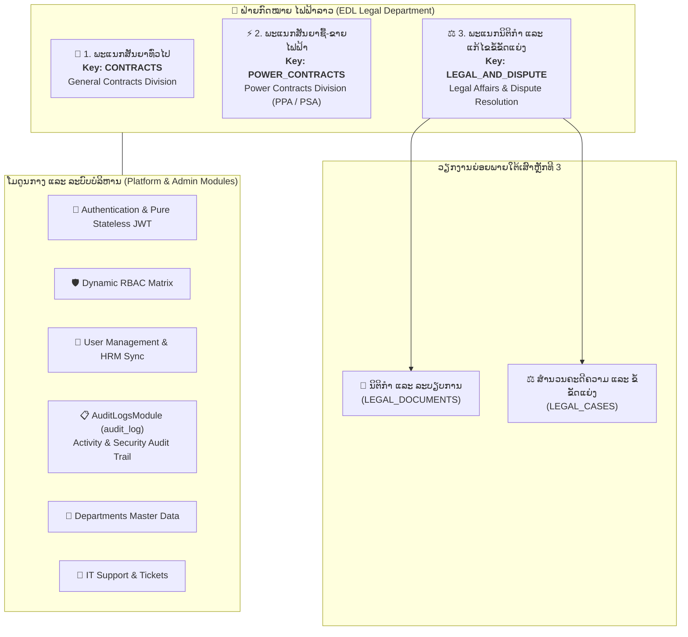

# ລາຍງານລະບົບຄຸ້ມຄອງສັນຍາ, ນິຕິກຳ ແລະ ຄະດີຄວາມ ໄຟຟ້າລາວ (EDL)
# System Development Timeline & Complete Module Specification Report

**ໂຄງການ (Project):** ລະບົບຄຸ້ມຄອງສັນຍາ, ນິຕິກຳ ແລະ ຄະດີຄວາມ ໄຟຟ້າລາວ (EDL Legal, Contracts & Disputes Management System)  
**ອົງກອນ (Organization):** ລັດວິສາຫະກິດໄຟຟ້າລາວ (Électricité du Laos - EDL)  
**ສະຖາປັດຕະຍະກຳ (Architecture):** Clean Architecture (4 Layers) + NestJS (Node.js ESM) + Prisma ORM 7 + PostgreSQL 16  
**ສະຖານະການທົດສອບ (Testing Status):** 109 Automated Tests Passed (100% Green across 8 Test Suites)  
**ວັນທີອັບເດດລາຍງານ (Report Updated):** 07 ພະຈິກ (November) 2026  
**ເວີຊັນລະບົບ (System Version):** 2.1 (Full Dynamic RBAC, Power Contracts, Audit Logs, Division Head Scoping & Expiry Notifications)  

---

## 📑 ສາລະບານ (Table of Contents)

1. [ພາບລວມລະບົບ ແລະ ໂຄງສ້າງ 3 ເສົາຫຼັກ (Executive Summary & 3 Core Pillars)](#1-ພາບລວມລະບົບ-ແລະ-ໂຄງສ້າງ-3-ເສົາຫຼັກ)
2. [ແຜນຜັງໄທມ໌ໄລນ໌ການພັດທະນາ (Master Development Timeline Diagram)](#2-ແຜນຜັງໄທມ໌ໄລນ໌ການພັດທະນາ)
3. [ຕາຕະລາງໄທມ໌ໄລນ໌ວິວັດທະນາການລາຍໂມດູນ (Module-by-Module Evolution Timeline)](#3-ຕາຕະລາງໄທມ໌ໄລນ໌ວິວັດທະນາການລາຍໂມດູນ)
4. [ລາຍລະອຽດໄທມ໌ໄລນ໌ແຕ່ລະເຟສຢ່າງລະອຽດ (Phase-by-Phase Deep Dive Timeline)](#4-ລາຍລະອຽດໄທມ໌ໄລນ໌ແຕ່ລະເຟສຢ່າງລະອຽດ)
   - [Phase 1: ວາງຮາກຖານ, Clean Architecture, ສັນຍາທົ່ວໄປ & Audit Logs ພື້ນຖານ (20 - 21 ຕຸລາ 2026)](#phase-1-ວາງຮາກຖານ-clean-architecture-ສັນຍາທົ່ວໄປ--audit-logs-ພື້ນຖານ-20---21-ຕຸລາ-2026)
   - [Phase 2: ເສົາຫຼັກທີ 3 - ພະແນກນິຕິກຳ ແລະ ຄະດີຄວາມ (21 - 23 ຕຸລາ 2026)](#phase-2-ເສົາຫຼັກທີ-3---ພະແນກນິຕິກຳ-ແລະ-ຄະດີຄວາມ-21---23-ຕຸລາ-2026)
   - [Phase 3: ເຊື່ອມຕໍ່ຖານຂໍ້ມູນພະນັກງານ HRM API & Fallback Engine (26 ຕຸລາ 2026)](#phase-3-ເຊື່ອມຕໍ່ຖານຂໍ້ມູນພະນັກງານ-hrm-api--fallback-engine-26-ຕຸລາ-2026)
   - [Phase 4: ເສົາຫຼັກທີ 2 - ພະແນກສັນຍາຊື້-ຂາຍໄຟຟ້າ PPA/PSA (29 - 30 ຕຸລາ 2026)](#phase-4-ເສົາຫຼັກທີ-2---ພະແນກສັນຍາຊື້-ຂາຍໄຟຟ້າ-ppapsa-29---30-ຕຸລາ-2026)
   - [Phase 5: ລະບົບສິດທິໄດນາມິກ Dynamic RBAC Matrix & DivisionGuard (02 - 03 ພະຈິກ 2026)](#phase-5-ລະບົບສິດທິໄດນາມິກ-dynamic-rbac-matrix--divisionguard-02---03-ພະຈິກ-2026)
   - [Phase 6: ຄວາມປອດໄພຂັ້ນສູງ Stateless Session & In-Memory Token Versioning (03 - 04 ພະຈິກ 2026)](#phase-6-ຄວາມປອດໄພຂັ້ນສູງ-stateless-session--in-memory-token-versioning-03---04-ພະຈິກ-2026)
   - [Phase 7: ອັບເກຣດໃຫຍ່ Audit Logs Stats/Filters & ລະບົບແຈ້ງເຕືອນສັນຍາໝົດອາຍຸ (04 ພະຈິກ 2026)](#phase-7-ອັບເກຣດໃຫຍ່-audit-logs-statsfilters--ລະບົບແຈ້ງເຕືອນສັນຍາໝົດອາຍຸ-04-ພະຈິກ-2026)
   - [Phase 8: Fresh Profile Schema, ເອກະສານລະບົບ & Docker Automation (05 - 06 ພະຈິກ 2026)](#phase-8-fresh-profile-schema-ເອກະສານລະບົບ--docker-automation-05---06-ພະຈິກ-2026)
   - [Phase 9: Division Head User Scoping & Target User Audit Trail (07 ພະຈິກ 2026 - ປັດຈຸບັນ)](#phase-9-division-head-user-scoping--target-user-audit-trail-07-ພະຈິກ-2026---ປັດຈຸບັນ)
5. [ລາຍລະອຽດສະເພາະເຈາະເລິກທັງ 11 ໂມດູນ (Comprehensive 11 Modules Specification)](#5-ລາຍລະອຽດສະເພາະເຈາະເລິກທັງ-11-ໂມດູນ)
   - [5.1 ໂມດູນສັນຍາທົ່ວໄປ (ContractsModule)](#51-ໂມດູນສັນຍາທົ່ວໄປ-contractsmodule)
   - [5.2 ໂມດູນປະເພດສັນຍາ (ContractTypesModule)](#52-ໂມດູນປະເພດສັນຍາ-contracttypesmodule)
   - [5.3 ໂມດູນສັນຍາຊື້-ຂາຍໄຟຟ້າ (PowerContractsModule)](#53-ໂມດູນສັນຍາຊື້-ຂາຍໄຟຟ້າ-powercontractsmodule)
   - [5.4 ໂມດູນນິຕິກຳ ແລະ ລະບຽບການ (LegalDocumentsModule)](#54-ໂມດູນນິຕິກຳ-ແລະ-ລະບຽບການ-legaldocumentsmodule)
   - [5.5 ໂມດູນຄະດີຄວາມ ແລະ ຂໍ້ຂັດແຍ່ງ (LegalCasesModule)](#55-ໂມດູນຄະດີຄວາມ-ແລະ-ຂໍ້ຂັດແຍ່ງ-legalcasesmodule)
   - [5.6 ໂມດູນຢັ້ງຢືນຕົວຕົນ (AuthModule)](#56-ໂມດູນຢັ້ງຢືນຕົວຕົນ-authmodule)
   - [5.7 ໂມດູນຈັດການບົດບາດ ແລະ ສິດທິ (RolesModule)](#57-ໂມດູນຈັດການບົດບາດ-ແລະ-ສິດທິ-rolesmodule)
   - [5.8 ໂມດູນຈັດການຜູ້ໃຊ້ງານ (UsersModule)](#58-ໂມດູນຈັດການຜູ້ໃຊ້ງານ-usersmodule)
   - [5.9 ໂມດູນພະແນກ ແລະ ຝ່າຍ (DepartmentsModule)](#59-ໂມດູນພະແນກ-ແລະ-ຝ່າຍ-departmentsmodule)
   - [5.10 ໂມດູນບັນທຶກປະຫວັດການເຄື່ອນໄຫວ ແລະ ຄວາມປອດໄພ (AuditLogsModule / audit_log)](#510-ໂມດູນບັນທຶກປະຫວັດການເຄື່ອນໄຫວ-ແລະ-ຄວາມປອດໄພ-auditlogsmodule--audit_log)
   - [5.11 ໂມດູນຊ່ວຍເຫຼືອ ແລະ ແຈ້ງບັນຫາ (SupportModule)](#511-ໂມດູນຊ່ວຍເຫຼືອ-ແລະ-ແຈ້ງບັນຫາ-supportmodule)
6. [ສະຖາປັດຕະຍະກຳຖານຂໍ້ມູນ ແລະ ປະຫວັດ Database Migrations (Database Evolution)](#6-ສະຖາປັດຕະຍະກຳຖານຂໍ້ມູນ-ແລະ-ປະຫວັດ-database-migrations)
7. [ການທົດສອບຄຸນນະພາບ ແລະ ຄວາມປອດໄພ (Quality Assurance & Test Verification)](#7-ການທົດສອບຄຸນນະພາບ-ແລະ-ຄວາມປອດໄພ)
8. [ຕາຕະລາງສະຫຼຸບສະຖານະປັດຈຸບັນ (Current Module Status Matrix)](#8-ຕາຕະລາງສະຫຼຸບສະຖານະປັດຈຸບັນ)

---

## 1. ພາບລວມລະບົບ ແລະ ໂຄງສ້າງ 3 ເສົາຫຼັກ

ລະບົບຄຸ້ມຄອງວຽກງານກົດໝາຍ, ສັນຍາ ແລະ ຄະດີຄວາມ ຂອງ **ລັດວິສາຫະກິດໄຟຟ້າລາວ (EDL)** ຖືກພັດທະນາຂຶ້ນເພື່ອເປັນແກນກາງດິຈິທັລໃນການບໍລິຫານຈັດການສັນຍາທຸກປະເພດ, ຕິດຕາມອາຍຸສັນຍາ, ຄຸ້ມຄອງນິຕິກຳ ແລະ ສຳນວນຄະດີຄວາມ ພາຍໃຕ້ການຊີ້ນຳຂອງ **ຝ່າຍກົດໝາຍ ໄຟຟ້າລາວ**.

ໂຄງສ້າງລະບົບຖືກແບ່ງອອກເປັນ **3 ເສົາຫຼັກ (3 Core Pillars / Divisions)** ຕາມໂຄງສ້າງຕົວຈິງຂອງອົງກອນ:



### ຫຼັກການສະຖາປັດຕະຍະກຳ (Architectural Foundations)
1. **Clean Architecture (4 Layers)**: ແບ່ງແຍກ Business Rules ອອກຈາກ Framework:
   - **Domain**: Entities, Enums, Value Objects, Repository Interfaces
   - **Infrastructure**: Prisma Repositories, Database Transactions, File Storage Engines, HTTP Clients
   - **Application**: Use Cases (Business Logic), Data Transfer Objects (DTOs), Helper Utilities
   - **Presentation**: REST Controllers, Decorators, Guards, File Streaming
2. **Pure Stateless JWT Security**: Token ບັນຈຸສິດທິລາຍລະອຽດທັງໝົດ (`permissionsByModule`, `accessibleModules`) ເຮັດໃຫ້ກວດສອບສິດໄດ້ໄວ 0 Database Queries.
3. **In-Memory Instant Session Invalidation**: ໃຊ້ `token_version` ແລະ `TokenVersionService` ຍົກເລີກ Session ທັນທີທີ່ສິດຖືກແກ້ໄຂ ພ້ອມ Seamless Auto-Refresh ທີ່ Replay Request ໄດ້ໂດຍບໍ່ຕ້ອງ Login ໃໝ່.
4. **URL Path Tampering Defense**: `DivisionGuard` ດັກຈັບການໂຈມຕີປ່ຽນ Path ເພື່ອເຂົ້າເຖິງຂ້າມພະແນກ ພ້ອມບັນທຶກ `SECURITY_ALERT` ອັດຕະໂນມັດລົງໃນ `audit_logs`.
5. **Real-time & Scheduled Expiry Engine**: ແຈ້ງເຕືອນສັນຍາໃກ້ໝົດອາຍຸ ($\le 60$ ວັນ) ທັງແບບ Real-time ຕອນສ້າງສັນຍາ ແລະ ແບບ Cron Job (00:05 ແລະ 00:08).

---

## 2. ແຜນຜັງໄທມ໌ໄລນ໌ການພັດທະນາ

```mermaid
flowchart TD
    Ph1["<b>Phase 1 (20-21 ຕ.ຄ. 2026)</b><br/>ວາງຮາກຖານລະບົບ & ພະແນກສັນຍາທົ່ວໄປ<br/>• Clean Architecture 4 Layers (NestJS ESM)<br/>• ContractsModule (14 ປະເພດສັນຍາ, 3 ສະກຸນເງິນ, ແນບໄຟລ໌)<br/>• ContractTypesModule (Master Data)<br/>• AuthModule, DepartmentsModule, SupportModule<br/>• <b>AuditLogsModule (audit_log ພື້ນຖານ)</b>"]
    
    Ph2["<b>Phase 2 (21-23 ຕ.ຄ. 2026)</b><br/>ພະແນກນິຕິກຳ ແລະ ຄະດີຄວາມ (ເສົາຫຼັກ 3)<br/>• LegalDocumentsModule (ນິຕິກຳ, ດຳລັດ, ຂໍ້ກຳນົດ, ຄົ້ນຫາຕາມປີ)<br/>• LegalCasesModule (ຄະດີ 4 ປະເພດ, 3 ຂັ້ນສານ, 2 ສະກຸນເງິນ LAK/USD)<br/>• ລະບົບຄຳນວນຍອດເງິນອັດຕະໂນມັດ Total Payable<br/>• Cloudflare Tunnel & Proxy Config"]
    
    Ph3["<b>Phase 3 (26 ຕ.ຄ. 2026)</b><br/>ເຊື່ອມຕໍ່ຖານຂໍ້ມູນພະນັກງານ HRM API<br/>• UsersModule: Auto-fill ຂໍ້ມູນຈາກ EDL HRM API<br/>• Resilient Fallback Engine ຮອງຮັບກໍລະນີ HRM Offline<br/>• Docker Uploads Storage Path Optimization"]
    
    Ph4["<b>Phase 4 (29-30 ຕ.ຄ. 2026)</b><br/>ພະແນກສັນຍາຊື້-ຂາຍໄຟຟ້າ (ເສົາຫຼັກ 2)<br/>• PowerContractsModule (PPA ສັນຍາຊື້ & PSA ສັນຍາຂາຍ)<br/>• 5 ປະເພດໂຄງການຜະລິດໄຟຟ້າ (ນໍ້າ, ແດດ, ລົມ, ຖ່ານຫີນ, ຊີວະມວນ)<br/>• Installed Capacity (MW), Tariff, ແນບໄຟລ໌ & History Log"]
    
    Ph5["<b>Phase 5 (02-03 ພ.ຍ. 2026)</b><br/>Dynamic RBAC & DivisionGuard Defense<br/>• RolesModule: ສ້າງ Custom Role ໃໝ່ໄດ້ແບບບໍ່ຈຳກັດ<br/>• Matrix 5 Actions (View, Upload, Edit, Delete, Download)<br/>• <b>DivisionGuard ດັກຈັບ Path Tampering ບັນທຶກ SECURITY_ALERT</b>"]
    
    Ph6["<b>Phase 6 (03-04 ພ.ຍ. 2026)</b><br/>Stateless Session & Token Versioning<br/>• Pure Stateless JWT (0 DB Query)<br/>• In-Memory TokenVersionService (Nano-sec Cache)<br/>• Instant Session Invalidation & Seamless Auto-Refresh"]
    
    Ph7["<b>Phase 7 (04 ພ.ຍ. 2026)</b><br/><b>ອັບເກຣດໃຫຍ່ AuditLogsModule & Expiry Notifications</b><br/>• <b>Audit Logs Stats API (ພາບລວມ 6 ໝວດໝູ່) & Multi-Filters</b><br/>• Dual Daily Cron Jobs (00:05 ສັນຍາທົ່ວໄປ, 00:08 ສັນຍາໄຟຟ້າ)<br/>• Instant Expiry Notifications (<= 60 ວັນ)"]
    
    Ph8["<b>Phase 8 (05-06 ພ.ຍ. 2026)</b><br/>Live Profile Schema & Deployment Scripts<br/>• Fresh Profile GET /api/auth/me ດຶງສິດສົດຈາກ DB<br/>• ເອກະສານລະບົບຄົບວົງຈອນ & Postman Collection V3<br/>• Deployment Scripts (seed-roles, seed.ts)"]
    
    Ph9["<b>Phase 9 (07 ພ.ຍ. 2026 - ປັດຈຸບັນ)</b><br/>Division Head User Scoping & Target User Audit<br/>• ຫົວໜ້າພະແນກ 3 ສາຍງານຈັດການ User ໄດ້ສະເພາະສາຍງານຕົນເອງ<br/>• <b>Audit Logs target_user_id Tracking</b><br/>• 109 Automated Tests Passed (100% Green)"]

    Ph1 --> Ph2 --> Ph3 --> Ph4 --> Ph5 --> Ph6 --> Ph7 --> Ph8 --> Ph9

    classDef done fill:#e8f5e9,stroke:#2e7d32,stroke-width:2px,color:#1b5e20;
    classDef highlight fill:#e3f2fd,stroke:#1565c0,stroke-width:2px,color:#0d47a1;
    class Ph1,Ph2,Ph3,Ph4,Ph5,Ph6,Ph7,Ph8 done;
    class Ph9 highlight;
```



---

## 3. ຕາຕະລາງໄທມ໌ໄລນ໌ວິວັດທະນາການລາຍໂມດູນ

ຕາຕະລາງສະແດງປະຫວັດການເລີ່ມຕົ້ນສ້າງ ແລະ ການພັດທະນາຕໍ່ຍອດຂອງທັງ 11 ໂມດູນ:

| # | ຊື່ໂມດູນ (Module) | ວັນທີເລີ່ມສ້າງ | ເສົາຫຼັກ / Division | ເຟສຫຼັກທີ່ພັດທະນາ / ປັບປຸງ | Commits ທີ່ກ່ຽວຂ້ອງ | ສະຖານະປັດຈຸບັນ |
| :- | :--- | :---: | :--- | :--- | :--- | :---: |
| **01** | **`ContractsModule`** | 20/10/2026 | `CONTRACTS` (ເສົາຫຼັກ 1) | Phase 1 (Core CRUD) ➔ Phase 7 (Instant Expiry & Cron) | `5aaa05b`, `bd70582` | **100% Ready** |
| **02** | **`ContractTypesModule`** | 20/10/2026 | `CONTRACTS` (ເສົາຫຼັກ 1) | Phase 1 (Master Data 14 ປະເພດ) ➔ Phase 2 (Clean Schema) | `5aaa05b` | **100% Ready** |
| **03** | **`PowerContractsModule`** | 29/10/2026 | `POWER_CONTRACTS` (ເສົາຫຼັກ 2) | Phase 4 (PPA/PSA Module) ➔ Phase 7 (Instant Expiry & Cron) | `5958794`, `bd70582` | **100% Ready** |
| **04** | **`LegalDocumentsModule`** | 21/10/2026 | `LEGAL_AND_DISPUTE` (ເສົາຫຼັກ 3) | Phase 2 (ນິຕິກຳ, ດຳລັດ, ແນບໄຟລ໌) ➔ Phase 5 (RBAC Matrix) | `5aaa05b`, `e31f016` | **100% Ready** |
| **05** | **`LegalCasesModule`** | 21/10/2026 | `LEGAL_AND_DISPUTE` (ເສົາຫຼັກ 3) | Phase 2 (ຄະດີ 4 ປະເພດ, 3 ຂັ້ນສານ, 2 ສະກຸນ) ➔ Phase 5 | `5aaa05b`, `e31f016` | **100% Ready** |
| **06** | **`AuthModule`** | 20/10/2026 | Common (ທຸກຄົນ) | Phase 1 (JWT) ➔ Phase 6 (Token Versioning) ➔ Phase 8 (Fresh Me) | `5aaa05b`, `e31f016`, `b7e8424` | **100% Ready** |
| **07** | **`RolesModule`** | 02/11/2026 | Admin Only | Phase 5 (Dynamic Custom RBAC Matrix & Session Invalidation) | `e31f016`, `ff1460d` | **100% Ready** |
| **08** | **`UsersModule`** | 20/10/2026 | Admin & Division Heads | Phase 1 (Base) ➔ Phase 3 (HRM Sync) ➔ Phase 9 (Division Head Scope) | `5aaa05b`, `6c52aa1`, `20261107` | **100% Ready** |
| **09** | **`DepartmentsModule`** | 20/10/2026 | Common (ທຸກຄົນ) | Phase 1 (Base Data) ➔ Phase 3 (HRM Sync & Dropdown) | `5aaa05b`, `b7e8424` | **100% Ready** |
| **10** | **`AuditLogsModule`<br/>(`audit_log`)** | **20/10/2026** | **Admin Only** | **Phase 1 (Base Schema)** ➔ **Phase 5 (Security Alert)** ➔ **Phase 7 (Stats & Filters)** ➔ **Phase 9 (Target User)** | `5aaa05b`, `3b2f411`, `6eb5440`, `20261107` | **100% Ready** |
| **11** | **`SupportModule`** | 20/10/2026 | Common (ທຸກຄົນ) | Phase 1 (Contact Channels & Support Tickets Workflow) | `5aaa05b` | **100% Ready** |

---

## 4. ລາຍລະອຽດໄທມ໌ໄລນ໌ແຕ່ລະເຟສຢ່າງລະອຽດ

---

### Phase 1: ວາງຮາກຖານ, Clean Architecture, ສັນຍາທົ່ວໄປ & Audit Logs ພື້ນຖານ (20 - 21 ຕຸລາ 2026)

* **ວັນທີ:** 20/10/2026 - 21/10/2026
* **Git Commits:** `5aaa05b` (first commit), `700073a` (updated docker-compose-file), `0bda5dc` (change-port)
* **Database Migrations:**
  - `20261020023020_init_schema`
  - `20261020030542_add_column_division_unit`
  - `20261020030650_add_column_division_unit_updated`
  - `20261020074232_remove_varchar_limits`

#### ເນື້ອໃນການພັດທະນາ:
1. **ວາງໂຄງສ້າງ Clean Architecture 4 Layers ດ້ວຍ NestJS ESM:**
   - ຕັ້ງຄ່າ NestJS 11 ພາຍໃຕ້ Node.js ECMAScript Modules (`"type": "module"`).
   - ແບ່ງ Layer ເປັນ `domain`, `infrastructure`, `application`, ແລະ `presentation` ຢ່າງຊັດເຈນ ເພື່ອໃຫ້ Maintain ງ່າຍໃນໄລຍະຍາວ.
2. **`ContractsModule` (ເສົາຫຼັກທີ 1 - ພະແນກສັນຍາທົ່ວໄປ):**
   - ຮອງຮັບສັນຍາ 14 ປະເພດ (ເຊົ່າດິນ, O&M, EPC, ບຳລຸງຮັກສາ, ທີ່ປຶກສາ, MOA, PTA, ແລະອື່ນໆ).
   - ຄຸ້ມຄອງສະຖານະສັນຍາ 5 ຮູບແບບ: `DRAFT`, `ACTIVE`, `EXPIRING_SOON`, `EXPIRED`, `TERMINATED`.
   - ຮອງຮັບ 3 ສະກຸນເງິນ: `LAK`, `USD`, `CNY` ພ້ອມມູນຄ່າສັນຍາ ແລະ ສະຫຼຸບມູນຄ່າລວມ.
   - ລະບົບຈັດເກັບໄຟລ໌ແນບ (`/uploads/contracts`) ຮອງຮັບ Preview Inline (PDF, ຮູບພາບ), ດາວໂຫຼດ, ແລະ Soft Delete.
3. **`ContractTypesModule`:** ຄຸ້ມຄອງ Master Data 14 ປະເພດສັນຍາ ພ້ອມ API Dropdown.
4. **`AuthModule`:** ລະບົບ Login ພື້ນຖານດ້ວຍ Local Database ແລະ ອອກ Access Token ດ້ວຍ JWT.
5. **`DepartmentsModule`:** ຕາຕະລາງ Master Data ຝ່າຍ/ພະແນກ ສຳລັບໃຊ້ໃນ Dropdown ທົ່ວລະບົບ.
6. **`SupportModule`:** ຊ່ອງທາງຕິດຕໍ່ IT Support ແລະ ລະບົບແຈ້ງປີ້ບັນຫາ (Tickets).
7. **`AuditLogsModule` (`audit_log` ພື້ນຖານ):**
   - ສ້າງຕາຕະລາງ `audit_logs` ຜ່ານ Migration `20261020023020_init_schema`.
   - ບັນທຶກປະຫວັດການກະທຳ: `CREATE_CONTRACT`, `UPDATE_CONTRACT`, `DELETE_CONTRACT`, `LOGIN`, `LOGOUT`.
   - ເກັບ IP Address, User Agent, Operator ID, Contract ID, ແລະ Old/New Values JSONB.
8. **Infrastructure:** ຕັ້ງຄ່າ Docker Compose ສຳລັບ PostgreSQL 16 ແລະ Prisma ORM 7 Engine.

---

### Phase 2: ເສົາຫຼັກທີ 3 - ພະແນກນິຕິກຳ ແລະ ຄະດີຄວາມ (21 - 23 ຕຸລາ 2026)

* **ວັນທີ:** 21/10/2026 - 23/10/2026
* **Git Commits:** `f7db53a` (cloudflare & port updates)
* **Database Migrations:**
  - `20261021033654_remove_unused_contract_type_fields`
  - `20261021102001_add_legal_documents_and_cases`

#### ເນື້ອໃນການພັດທະນາ:
1. **`LegalDocumentsModule` (ວຽກງານນິຕິກຳ):**
   - ຄຸ້ມຄອງເອກະສານນິຕິກຳ 10 ປະເພດ (ກົດໝາຍ, ດຳລັດປະທານປະເທດ, ດຳລັດນາຍົກ, ຂໍ້ຕົກລົງລັດຖະມົນຕີ, ຂໍ້ກຳນົດ, ບົດແນະນຳ, ລະບຽບການ, ແຈ້ງການ, ສັນຍາ, ອື່ນໆ).
   - ລະບົບ Filter ຕາມປີອອກເອກະສານ, ເລກທີ, ຝ່າຍທີ່ກ່ຽວຂ້ອງ, ສະຖານະ (`ACTIVE`, `INACTIVE`).
   - ລະບົບຈັດເກັບໄຟລ໌ແນບນິຕິກຳ (`/uploads/documents`) ພ້ອມ Preview ແລະ Download.
   - Dashboard ສະຖິຕິນິຕິກຳແຍກຕາມປະເພດ ແລະ ປີ.
2. **`LegalCasesModule` (ວຽກງານຄະດີຄວາມ ແລະ ຂໍ້ຂັດແຍ່ງ):**
   - ຄຸ້ມຄອງສຳນວນຄະດີ 4 ປະເພດ: ແພ່ງ, ອາຍາ, ການຄ້າ, ບໍລິຫານ.
   - ຕິດຕາມຂັ້ນຕອນສານ 3 ຂັ້ນ: ສານຂັ້ນຕົ້ນ (`FIRST_INSTANCE`), ສານອຸທອນ (`APPEAL`), ສານລົບລ້າງ (`SUPREME`), ແລະ ສະຖານະສິ້ນສຸດ (`CLOSED`, `RESOLVED`).
   - ລະບົບບັນຊີການເງິນຄະດີຄວາມ 2 ສະກຸນເງິນ (`LAK` ແລະ `USD`):
     - ມູນຄ່າຄວາມເສຍຫາຍ (Claim Amount)
     - ຄ່າປັບໃໝ ແລະ ຄ່າທຳນຽມ (Fine / Fee)
     - **ລວມຍອດຕ້ອງຊຳລະ (Total Payable)** — ຄຳນວນອັດຕະໂນມັດ (Claim + Fine)
     - ຍອດກູ້ຄືນໄດ້ (Recovered Amount)
   - ລະບົບໄຟລ໌ແນບສຳນວນຄະດີ (`/uploads/cases`) ແລະ Dashboard ສະຫຼຸບມູນຄ່າຄະດີ.
3. **Audit Log Integration:** ເພີ່ມ Actions ໃໝ່: `CREATE_LEGAL_DOC`, `UPDATE_LEGAL_DOC`, `DELETE_LEGAL_DOC`, `CREATE_LEGAL_CASE`, `UPDATE_LEGAL_CASE`, `DELETE_LEGAL_CASE`.

---

### Phase 3: ເຊື່ອມຕໍ່ຖານຂໍ້ມູນພະນັກງານ HRM API & Fallback Engine (26 ຕຸລາ 2026)

* **ວັນທີ:** 26/10/2026
* **Git Commits:** `6c52aa1` (edit create user usecase), `b2c4512` (edit port), `301b16d` (fix upload dir env for docker), `88269c1` (untrack env docker example)

#### ເນື້ອໃນການພັດທະນາ:
1. **`UsersModule` & HRM Sync:**
   - ເຊື່ອມຕໍ່ EDL HRM API (`https://api-test.edl.com.la/hrm/api`).
   - ພັດທະນາລະບົບຄົ້ນຫາ ແລະ Auto-fill ຂໍ້ມູນພະນັກງານ (`GET /api/users/hrm/:empCode`).
   - **Resilient Fallback Mechanism:** ຫາກເຊີເວີ HRM Offline, Network Timeout ຫຼື ພະນັກງານບໍ່ມີໃນ HRM, ລະບົບຈະຍັງສາມາດສ້າງ/ແກ້ໄຂຜູ້ໃຊ້ຜ່ານ Local Database ໄດ້ປົກກະຕິ.
2. **Docker Storage & Network Environment:**
   - ແຍກ Environment Variables ສຳລັບ Storage Upload Directories ໃຫ້ຮອງຮັບ Docker Mount Volumes ຢ່າງສົມບູນ.

---

### Phase 4: ເສົາຫຼັກທີ 2 - ພະແນກສັນຍາຊື້-ຂາຍໄຟຟ້າ PPA/PSA (29 - 30 ຕຸລາ 2026)

* **ວັນທີ:** 29/10/2026 - 30/10/2026
* **Git Commits:** `5958794` (module PPA), `3b2f411` (Update edit error)
* **Database Migrations:** `20261029032949_add_power_contracts_module`

#### ເນື້ອໃນການພັດທະນາ:
1. **`PowerContractsModule` (ເສົາຫຼັກທີ 2 - ພະແນກສັນຍາຊື້-ຂາຍໄຟຟ້າ):**
   - ຄຸ້ມຄອງສັນຍາຊື້ໄຟຟ້າ (PPA - Power Purchase Agreement) ແລະ ສັນຍາຂາຍໄຟຟ້າ (PSA - Power Sale Agreement).
   - ຮອງຮັບໂຄງການຜະລິດໄຟຟ້າ 5 ປະເພດ: ໄຟຟ້ານໍ້າຕົກ (HYDRO), ແສງຕາເວັນ (SOLAR), ພະລັງງານລົມ (WIND), ຄວາມຮ້ອນ/ຖ່ານຫີນ (THERMAL), ແລະ ຊີວະມວນ (BIOMASS).
   - ຕິດຕາມກຳລັງການຕິດຕັ້ງ (Installed Capacity: MW / kW) ແລະ ອັດຕາຄ່າໄຟຟ້າ (Tariff).
   - ລະບົບຈັດເກັບໄຟລ໌ແນບສັນຍາໄຟຟ້າແຍກສະເພາະ (`/uploads/power-contracts`).
   - Dashboard ສະຖິຕິສັນຍາໄຟຟ້າ: ກຳລັງຕິດຕັ້ງລວມ, ມູນຄ່າແຍກຕາມສະກຸນເງິນ, ຈຳນວນໂຄງການແຍກຕາມປະເພດ.
   - ລະບົບບັນທຶກປະຫວັດການດັດແກ້ສັນຍາໄຟຟ້າ (History Log).
2. **Audit Log Expansion:** ເພີ່ມ `powerContractId` foreign key ໃນຕາຕະລາງ `audit_logs` ພ້ອມ Actions ສັນຍາໄຟຟ້າ: `CREATE_POWER_CONTRACT`, `UPDATE_POWER_CONTRACT`, `DELETE_POWER_CONTRACT`, `DOWNLOAD_POWER_ATTACHMENT`.

---

### Phase 5: ລະບົບສິດທິໄດນາມິກ Dynamic RBAC Matrix & DivisionGuard (02 - 03 ພະຈິກ 2026)

* **ວັນທີ:** 02/11/2026 - 03/11/2026
* **Git Commits:** `e31f016` (edit role)
* **Database Migrations:** `20261102070700_add_custom_roles_and_permissions`

#### ເນື້ອໃນການພັດທະນາ:
1. **`RolesModule` (Dynamic Custom Roles & RBAC Matrix):**
   - ຍົກລະດັບຈາກ Static Roles ມາເປັນ **Dynamic Custom Roles**: Admin ສາມາດສ້າງ, ແກ້ໄຂ, ແລະ ລົບບົດບາດໃໝ່ໄດ້ແບບບໍ່ຈຳກັດ.
   - **5 Actions Permission Matrix**: ກຳນົດສິດລະອຽດລະດັບ Action (`canView`, `canUpload`, `canEdit`, `canDelete`, `canDownload`) ຕໍ່ 3 ເສົາຫຼັກ:
     1. `CONTRACTS` (ພະແນກສັນຍາທົ່ວໄປ)
     2. `POWER_CONTRACTS` (ພະແນກສັນຍາຊື້-ຂາຍໄຟຟ້າ)
     3. `LEGAL_AND_DISPUTE` (ພະແນກນິຕິກຳ ແລະ ແກ້ໄຂຂໍ້ຂັດແຍ່ງ)
   - ລະບົບປ້ອງກັນ **System Roles** (ADMIN, DIVISION_HEAD, MAIN_USER, VIEWER, DEPARTMENT_HEAD) ບໍ່ໃຫ້ຖືກລົບ.
2. **`DivisionGuard` & Security Alert Logging:**
   - Multi-layer Guard Architecture: `JwtAuthGuard` ➔ `RolesGuard` ➔ `DivisionGuard`.
   - **Path Tampering Defense:** ກວດຈັບຫາກຜູ້ໃຊ້ພະຍາຍາມແກ້ໄຂ URL Path ເພື່ອເຂົ້າເຖິງໂມດູນອື່ນທີ່ບໍ່ມີສິດ, ລະບົບຈະ Block ທັນທີດ້ວຍ `403 Forbidden` ແລະ **ບັນທຶກ `SECURITY_ALERT` ລົງໃນ `AuditLogsModule` (`audit_logs`) ອັດຕະໂນມັດ**.

---

### Phase 6: ຄວາມປອດໄພຂັ້ນສູງ Stateless Session & In-Memory Token Versioning (03 - 04 ພະຈິກ 2026)

* **ວັນທີ:** 03/11/2026 - 04/11/2026
* **Git Commits:** `e31f016`, `6eb5440` (fix: role)
* **Database Migrations:** `20261103094500_add_token_version_and_refresh_token`

#### ເນື້ອໃນການພັດທະນາ:
1. **Pure Stateless JWT + In-Memory Token Versioning:**
   - ຝັງສິດທິ `permissionsByModule` ແລະ `accessibleModules` ລົງໃນ Access Token ໂດຍກົງ ເຮັດໃຫ້ Backend Guard ກວດສອບສິດໄດ້ໄວລະດັບ Microsecond ໂດຍ **0 Database Queries**.
   - ເພີ່ມຟິວ `token_version` (INT) ແລະ `refresh_token` ໃນຕາຕະລາງ `users`.
   - ສ້າງ `TokenVersionService` (In-Memory Cache) ສຳລັບ Fast Lookup ລະດັບ Nano-second.
2. **Instant Invalidation & Seamless Auto-Refresh:**
   - ເມື່ອ Admin ແກ້ໄຂ Role ຫຼື ສິດທິຂອງ User, ລະບົບຈະເພີ່ມ `token_version` ທັນທີ. Access Token ເກົ່າທີ່ຄ້າງຢູ່ໃນ Browser ຈະຖືກປະຕິເສດດ້ວຍ `401 TOKEN_OUTDATED`.
   - **Seamless Auto-Refresh**: Frontend Axios Interceptor ດັກຈັບ `TOKEN_OUTDATED` ແລ້ວສົ່ງ `POST /api/auth/refresh` ໄປດຶງ Token ໃໝ່ພ້ອມສິດລ່າສຸດ ແລ້ວ Replay Request ເດີມອັດຕະໂນມັດ ໂດຍຜູ້ໃຊ້ບໍ່ຕ້ອງ Login ໃໝ່.

---

### Phase 7: ອັບເກຣດໃຫຍ່ Audit Logs Stats/Filters & ລະບົບແຈ້ງເຕືອນສັນຍາໝົດອາຍຸ (04 ພະຈິກ 2026)

* **ວັນທີ:** 04/11/2026
* **Git Commits:** `6eb5440` (fix: role & audit logs stats/filters), `bd70582` (fix(notifications): support EXPIRING_SOON/EXPIRED status filter and auto-generate notifications)

#### ເນື້ອໃນການພັດທະນາ:
1. **ອັບເກຣດໃຫຍ່ `AuditLogsModule` (`audit_log`):**
   - **Stats API (`GET /api/audit-logs/stats`):** ສ້າງລະບົບສະຖິຕິພາບລວມການເຄື່ອນໄຫວໃນລະບົບ:
     - `totalLogs`: ຈຳນວນ Logs ທັງໝົດ
     - `todayLogs`: ຈຳນວນ Logs ມື້ນີ້
     - `securityChanges`: ການປ່ຽນແປງດ້ານຄວາມປອດໄພ/ສິດທິ
     - `contractChanges`: ການດັດແກ້ສັນຍາທົ່ວໄປ ແລະ ສັນຍາໄຟຟ້າ
     - `legalChanges`: ການດັດແກ້ນິຕິກຳ ແລະ ຄະດີຄວາມ
     - `attachmentActions`: ການອັບໂຫຼດ/ດາວໂຫຼດໄຟລ໌ແນບ
     - `roleChanges`: ການສ້າງ/ແກ້ໄຂ/ລົບບົດບາດ
   - **Multi-Dimensional Filter (`GET /api/audit-logs`):**
     - Filter ຕາມ **6 Categories ໃຫຍ່**: `SECURITY`, `CONTRACTS`, `POWER_CONTRACTS`, `LEGAL`, `ATTACHMENTS`, `ROLES`.
     - Filter ຕາມ `action`, `search`, `contractId`, `powerContractId`, `userId`, `startDate`, `endDate`.
     - Pagination & Meta Response (`total`, `page`, `limit`, `totalPages`).
2. **Automated Expiry Engine & Instant Notifications:**
   - **Daily Cron Jobs:**
     - `ContractExpiryCronService`: ເຮັດວຽກທຸກທ່ຽງຄືນ ເວລາ **00:05** ເພື່ອກວດສອບສັນຍາທົ່ວໄປທີ່ມີອາຍຸເຫຼືອ &le; 60 ວັນ ຫຼື ກາຍກຳນົດ.
     - `PowerContractExpiryCronService`: ເຮັດວຽກທຸກທ່ຽງຄືນ ເວລາ **00:08** ເພື່ອກວດສອບສັນຍາຊື້-ຂາຍໄຟຟ້າ.
   - **Instant Notification Generation (ສ້າງແຈ້ງເຕືອນທັນທີ):**
     - ເມື່ອມີການສ້າງສັນຍາໃໝ່ (Create) ຫຼື ແກ້ໄຂສັນຍາ (Update) ທີ່ມີວັນໝົດອາຍຸ &le; 60 ວັນ ຫຼື ໝົດອາຍຸແລ້ວ, ລະບົບຈະປັບສະຖານະເປັນ `EXPIRING_SOON` ຫຼື `EXPIRED` ແລະ ສ້າງ Notification ໃນລະບົບທັນທີ ໂດຍບໍ່ຕ້ອງລໍຖ້າຮອດທ່ຽງຄືນ.
   - **Manual Trigger APIs:**
     - `POST /api/notifications/trigger-check`
     - `POST /api/power-notifications/trigger-check`

---

### Phase 8: Fresh Profile Schema, ເອກະສານລະບົບ & Docker Automation (05 - 06 ພະຈິກ 2026)

* **ວັນທີ:** 05/11/2026 - 06/11/2026
* **Git Commits:** `b7e8424` (docs update & fresh profile schema), `ff1460d` (seed scripts & env loader), `a9dce6a` (seed-role docker-compose command)

#### ເນື້ອໃນການພັດທະນາ:
1. **Fresh Profile Schema (`GET /api/auth/me`):**
   - ປັບປຸງໃຫ້ດຶງຂໍ້ມູນຜູ້ໃຊ້, Role, Division, ແລະ Permissions Matrix ສົດໆ ຈາກ Database ສະເໝີ ເພື່ອໃຫ້ Frontend ໄດ້ຮັບສິດລ່າສຸດ 100%.
2. **ເອກະສານລະບົບຄົບວົງຈອນ (Comprehensive Documentation):**
   - ຈັດທຳ `SYSTEM_FLOW_AND_MODULES.md` ສະບັບສົມບູນ ພ້ອມ Sequence Diagrams.
   - ຈັດທຳ `FRONTEND_API_SUMMARY.md` ສະຫຼຸບ Endpoint ທັງໝົດ.
   - ຈັດທຳ `FRONTEND_RBAC_INTEGRATION_GUIDE.md` ຄູ່ມືການເຊື່ອມຕໍ່ Frontend.
   - ອັບເດດ `legal-contract-management.postman_collection.json` (V3) ລວມທັງໂຟລເດີ Audit Logs.
3. **Deployment & Seeding Automation:**
   - ສ້າງສະຄຣິບ `npm run seed` ແລະ `npm run seed:roles` ພ້ອມ Dotenv Loader ທີ່ຮອງຮັບທັງ Local ແລະ Docker Container.

---

### Phase 9: Division Head User Scoping & Target User Audit Trail (07 ພະຈິກ 2026 - ປັດຈຸບັນ)

* **ວັນທີ:** 07/11/2026 (ປັດຈຸບັນ)
* **Database Migrations:** `20261107143915_add_target_user`
* **Test Suite Status:** 8 Test Files, 109 Passed Tests (100% Green)

#### ເນື້ອໃນການພັດທະນາ:
1. **Division Head User Scoping (ການຈຳກັດສິດຫົວໜ້າພະແນກ):**
   - ຫົວໜ້າພະແນກ 3 ສາຍງານຫຼັກ (`DIV_GENERAL_CONTRACTS`, `DIV_POWER_CONTRACTS`, `DIV_LEGAL_AFFAIRS`):
     - ສາມາດເບິ່ງ (`GET /api/users`), ສ້າງ (`POST /api/users`), ແລະ ແກ້ໄຂ (`PATCH /api/users/:id`) ໄດ້ສະເພາະພະນັກງານທີ່ສັງກັດໃນພະແນກຂອງຕົນເອງເທົ່ານັ້ນ.
     - ຫາກພະຍາຍາມສ້າງ ຫຼື ແກ້ໄຂ User ທີ່ສັງກັດພະແນກອື່ນ, ລະບົບຈະ Block ດ້ວຍ `403 Forbidden` ທັນທີ.
     - ບໍ່ສາມາດແຕ່ງຕັ້ງສິດເປັນ `ADMIN` ໄດ້ (ອະນຸຍາດສະເພາະບົດບາດພາຍໃນສາຍງານ).
2. **Target User Audit Trail ໃນ `AuditLogsModule` (`audit_log`):**
   - ເພີ່ມຟິວ `target_user_id` ໃນຕາຕະລາງ `audit_logs` ເພື່ອຕິດຕາມຢ່າງຊັດເຈນວ່າ ການດຳເນີນງານໃດ (ເຊັ່ນ: `CREATE_USER`, `UPDATE_USER`, `DELETE_USER`, `ROLE_CHANGE`) ເຮັດຕໍ່ຜູ້ໃຊ້ງານຄົນໃດ.
   - Controller & Repository ຮອງຮັບການ Query Audit Logs ຕາມ `targetUserId`.
   - ຮອງຮັບ Fallback ດຶງຂໍ້ມູນ Target User ຈາກ `oldValues`/`newValues` JSONB ຫາກ User ນັ້ນຖືກລົບອອກຈາກລະບົບໄປແລ້ວ.
3. **Quality Assurance & Verification:**
   - ຂຽນ Automated Unit/Integration Tests ເພີ່ມຕື່ມ: `test/division-head-user-creation.spec.ts` ແລະ `test/audit-logs-target-user.spec.ts`.
   - ຜົນການທົດສອບລວມ: **109 Tests ຜ່ານທັງໝົດ 100%**.

---

## 5. ລາຍລະອຽດສະເພາະເຈາະເລິກທັງ 11 ໂມດູນ

---

### 5.1 ໂມດູນສັນຍາທົ່ວໄປ (`ContractsModule`)
* **ໂຟລເດີ:** `src/modules/contracts`
* **ເສົາຫຼັກ / Division:** ພະແນກສັນຍາທົ່ວໄປ (`CONTRACTS` / `ພະແນກສັນຍາທົ່ວໄປ`)
* **ສິດທີ່ຕ້ອງການ:** `canView`, `canUpload`, `canEdit`, `canDelete`, `canDownload` ໃນໂມດູນ `CONTRACTS` ຫຼື ບົດບາດ `ADMIN`
* **ຕາຕະລາງ DB:**
  - `contracts`: ຂໍ້ມູນຫຼັກຂອງສັນຍາ
  - `contract_attachments`: ໄຟລ໌ແນບສັນຍາ
  - `contract_download_logs`: ບັນທຶກປະຫວັດການດາວໂຫຼດໄຟລ໌
  - `notifications`: ການແຈ້ງເຕືອນສັນຍາໝົດອາຍຸ
* **Controllers & Services:**
  - `ContractsController` (`/api/contracts`)
  - `ContractAttachmentsController` (`/api/contracts/attachments`)
  - `NotificationsController` (`/api/notifications`)
  - `ContractExpiryCronService` (Cron Job 00:05 ທຸກທ່ຽງຄືນ)
* **Use Cases ທັງ 14 Use Cases:**
  `CreateContractUseCase`, `UpdateContractUseCase`, `DeleteContractUseCase`, `GetContractsUseCase`, `GetContractByIdUseCase`, `GetContractHistoryUseCase`, `GetDashboardStatsUseCase`, `UploadAttachmentUseCase`, `PreviewAttachmentUseCase`, `DownloadAttachmentUseCase`, `DeleteAttachmentUseCase`, `GetAttachmentsUseCase`, `GetNotificationsUseCase`, `MarkNotificationReadUseCase`
* **API Endpoints Catalog:**

| Method | Endpoint | Guards / Permission | ລາຍລະອຽດໜ້າທີ່ |
| :--- | :--- | :--- | :--- |
| `GET` | `/api/contracts` | `CONTRACTS` + `canView` | ດຶງລາຍການສັນຍາ (Search, Status Filter, Date Range, Pagination) |
| `GET` | `/api/contracts/dashboard` | `CONTRACTS` + `canView` | ດຶງສະຖິຕິ Dashboard (ຈຳນວນແຍກຕາມສະຖານະ, ມູນຄ່າແຍກຕາມສະກຸນເງິນ) |
| `GET` | `/api/contracts/:id` | `CONTRACTS` + `canView` | ດຶງລາຍລະອຽດສັນຍາ 1 ລາຍການ ພ້ອມໄຟລ໌ແນບ |
| `GET` | `/api/contracts/:id/history` | `CONTRACTS` + `canView` | ດຶງປະຫວັດການດັດແກ້ສັນຍາ (History Audit) |
| `POST` | `/api/contracts` | `CONTRACTS` + `canUpload` | ສ້າງສັນຍາໃໝ່ (ກວດສອບວັນໝົດອາຍຸ ແລະ ສ້າງ Notification ທັນທີ) |
| `PATCH` | `/api/contracts/:id` | `CONTRACTS` + `canEdit` | ແກ້ໄຂຂໍ້ມູນສັນຍາ |
| `DELETE` | `/api/contracts/:id` | `CONTRACTS` + `canDelete` | ລົບສັນຍາ (Soft Delete) |
| `POST` | `/api/contracts/:id/attachments` | `CONTRACTS` + `canUpload` | ອັບໂຫຼດໄຟລ໌ແນບ (PDF, ຮູບພາບ, Word) |
| `GET` | `/api/contracts/attachments/preview/:id` | `CONTRACTS` + `canView` | Preview ໄຟລ໌ແບບ Inline Stream (PDF / Images) |
| `GET` | `/api/contracts/attachments/download/:id` | `CONTRACTS` + `canDownload` | ດາວໂຫຼດໄຟລ໌ ພ້ອມບັນທຶກ Download Log |
| `DELETE` | `/api/contracts/attachments/:id` | `CONTRACTS` + `canDelete` | ລົບໄຟລ໌ແນບ |
| `GET` | `/api/notifications` | `CONTRACTS` + `canView` | ດຶງລາຍການແຈ້ງເຕືອນສັນຍາ (ຮອງຮັບ Filter `EXPIRING_SOON`, `EXPIRED`) |
| `PATCH` | `/api/notifications/:id/read` | `CONTRACTS` + `canView` | ໝາຍການແຈ້ງເຕືອນວ່າອ່ານແລ້ວ |
| `POST` | `/api/notifications/trigger-check` | `ADMIN` Only | Manual Trigger ສັ່ງ Run ການກວດສອບສັນຍາໝົດອາຍຸທັນທີ |

---

### 5.2 ໂມດູນປະເພດສັນຍາ (`ContractTypesModule`)
* **ໂຟລເດີ:** `src/modules/contract-types`
* **ເສົາຫຼັກ / Division:** ພະແນກສັນຍາທົ່ວໄປ (`CONTRACTS`)
* **ຕາຕະລາງ DB:** `contract_types`
* **Controllers & Services:** `ContractTypesController` (`/api/contract-types`)
* **Use Cases ທັງ 6 Use Cases:**
  `CreateContractTypeUseCase`, `UpdateContractTypeUseCase`, `DeleteContractTypeUseCase`, `GetContractTypesUseCase`, `GetContractTypeByIdUseCase`, `GetContractTypesDropdownUseCase`
* **API Endpoints Catalog:**

| Method | Endpoint | Guards / Permission | ລາຍລະອຽດໜ້າທີ່ |
| :--- | :--- | :--- | :--- |
| `GET` | `/api/contract-types/dropdown` | Authenticated Users | ດຶງລາຍຊື່ປະເພດສັນຍາ 14 ປະເພດ ສຳລັບ Select Dropdown |
| `GET` | `/api/contract-types` | `CONTRACTS` + `canView` | ດຶງລາຍການປະເພດສັນຍາທັງໝົດ |
| `GET` | `/api/contract-types/:id` | `CONTRACTS` + `canView` | ດຶງລາຍລະອຽດປະເພດສັນຍາ |
| `POST` | `/api/contract-types` | `ADMIN` Only | ສ້າງປະເພດສັນຍາໃໝ່ |
| `PATCH` | `/api/contract-types/:id` | `ADMIN` Only | ແກ້ໄຂປະເພດສັນຍາ |
| `DELETE` | `/api/contract-types/:id` | `ADMIN` Only | ລົບປະເພດສັນຍາ (ປ້ອງກັນຫາກມີສັນຍານຳໃຊ້ອ້າງອີງຢູ່) |

---

### 5.3 ໂມດູນສັນຍາຊື້-ຂາຍໄຟຟ້າ (`PowerContractsModule`)
* **ໂຟລເດີ:** `src/modules/power-contracts`
* **ເສົາຫຼັກ / Division:** ພະແນກສັນຍາຊື້-ຂາຍໄຟຟ້າ (`POWER_CONTRACTS` / `ພະແນກສັນຍາຊື້-ຂາຍໄຟຟ້າ`)
* **ສິດທີ່ຕ້ອງການ:** `canView`, `canUpload`, `canEdit`, `canDelete`, `canDownload` ໃນໂມດູນ `POWER_CONTRACTS` ຫຼື ບົດບາດ `ADMIN`
* **ຕາຕະລາງ DB:**
  - `power_contracts`: ຂໍ້ມູນສັນຍາຊື້ໄຟຟ້າ (PPA) ແລະ ຂາຍໄຟຟ້າ (PSA)
  - `power_contract_attachments`: ໄຟລ໌ແນບສັນຍາໄຟຟ້າ
  - `power_contract_download_logs`: ບັນທຶກປະຫວັດການດາວໂຫຼດ
  - `power_notifications`: ການແຈ້ງເຕືອນສັນຍາໄຟຟ້າໝົດອາຍຸ
* **Controllers & Services:**
  - `PowerContractsController` (`/api/power-contracts`)
  - `PowerAttachmentsController` (`/api/power-contracts/attachments`)
  - `PowerNotificationsController` (`/api/power-notifications`)
  - `PowerContractExpiryCronService` (Cron Job 00:08 ທຸກທ່ຽງຄືນ)
* **Use Cases ທັງ 15 Use Cases:**
  `CreatePowerContractUseCase`, `UpdatePowerContractUseCase`, `DeletePowerContractUseCase`, `GetPowerContractsUseCase`, `GetPowerContractByIdUseCase`, `GetPowerContractHistoryUseCase`, `GetPowerDashboardStatsUseCase`, `GetPowerProjectTypesUseCase`, `UploadPowerAttachmentUseCase`, `PreviewPowerAttachmentUseCase`, `DownloadPowerAttachmentUseCase`, `DeletePowerAttachmentUseCase`, `GetPowerAttachmentsUseCase`, `GetPowerNotificationsUseCase`, `MarkPowerNotificationReadUseCase`
* **API Endpoints Catalog:**

| Method | Endpoint | Guards / Permission | ລາຍລະອຽດໜ້າທີ່ |
| :--- | :--- | :--- | :--- |
| `GET` | `/api/power-contracts` | `POWER_CONTRACTS` + `canView` | ດຶງລາຍການສັນຍາໄຟຟ້າ (Filter PPA/PSA, Project Type, Status, Search) |
| `GET` | `/api/power-contracts/dashboard` | `POWER_CONTRACTS` + `canView` | Dashboard ສະຖິຕິສັນຍາໄຟຟ້າ (ກຳລັງຕິດຕັ້ງ MW, ມູນຄ່າແຍກສະກຸນເງິນ) |
| `GET` | `/api/power-contracts/project-types` | `POWER_CONTRACTS` + `canView` | ດຶງລາຍຊື່ປະເພດໂຄງການໄຟຟ້າ 5 ປະເພດ (HYDRO, SOLAR, WIND, THERMAL, BIOMASS) |
| `GET` | `/api/power-contracts/:id` | `POWER_CONTRACTS` + `canView` | ດຶງລາຍລະອຽດສັນຍາໄຟຟ້າ 1 ລາຍການ |
| `GET` | `/api/power-contracts/:id/history` | `POWER_CONTRACTS` + `canView` | ດຶງປະຫວັດການປ່ຽນແປງສັນຍາໄຟຟ້າ |
| `POST` | `/api/power-contracts` | `POWER_CONTRACTS` + `canUpload` | ສ້າງສັນຍາໄຟຟ້າໃໝ່ (ກວດສອບວັນໝົດອາຍຸ ແລະ ສ້າງ Notification ທັນທີ) |
| `PATCH` | `/api/power-contracts/:id` | `POWER_CONTRACTS` + `canEdit` | ແກ້ໄຂສັນຍາໄຟຟ້າ |
| `DELETE` | `/api/power-contracts/:id` | `POWER_CONTRACTS` + `canDelete` | ລົບສັນຍາໄຟຟ້າ |
| `POST` | `/api/power-contracts/:id/attachments` | `POWER_CONTRACTS` + `canUpload` | ອັບໂຫຼດໄຟລ໌ແນບສັນຍາໄຟຟ້າ |
| `GET` | `/api/power-contracts/attachments/preview/:id` | `POWER_CONTRACTS` + `canView` | Preview ໄຟລ໌ແນບແບບ Inline Stream |
| `GET` | `/api/power-contracts/attachments/download/:id` | `POWER_CONTRACTS` + `canDownload` | ດາວໂຫຼດໄຟລ໌ແນບ ພ້ອມບັນທຶກ Download Log |
| `DELETE` | `/api/power-contracts/attachments/:id` | `POWER_CONTRACTS` + `canDelete` | ລົບໄຟລ໌ແນບສັນຍາໄຟຟ້າ |
| `GET` | `/api/power-notifications` | `POWER_CONTRACTS` + `canView` | ດຶງລາຍການແຈ້ງເຕືອນສັນຍາໄຟຟ້າ |
| `PATCH` | `/api/power-notifications/:id/read` | `POWER_CONTRACTS` + `canView` | ໝາຍການແຈ້ງເຕືອນສັນຍາໄຟຟ້າວ່າອ່ານແລ້ວ |
| `POST` | `/api/power-notifications/trigger-check` | `ADMIN` Only | Manual Trigger ກວດສອບອາຍຸສັນຍາໄຟຟ້າທັນທີ |

---

### 5.4 ໂມດູນນິຕິກຳ ແລະ ລະບຽບການ (`LegalDocumentsModule`)
* **ໂຟລເດີ:** `src/modules/legal-documents`
* **ເສົາຫຼັກ / Division:** ພະແນກນິຕິກຳ ແລະ ແກ້ໄຂຂໍ້ຂັດແຍ່ງ (`LEGAL_AND_DISPUTE` / `ພະແນກນິຕິກຳ ແລະ ແກ້ໄຂຂໍ້ຂັດແຍ່ງ`)
* **ສິດທີ່ຕ້ອງການ:** `canView`, `canUpload`, `canEdit`, `canDelete`, `canDownload` ໃນໂມດູນ `LEGAL_AND_DISPUTE` ຫຼື ບົດບາດ `ADMIN`
* **ຕາຕະລາງ DB:**
  - `legal_documents`: ຂໍ້ມູນເອກະສານນິຕິກຳ, ດຳລັດ, ຂໍ້ກຳນົດ, ແຈ້ງການ
  - `document_attachments`: ໄຟລ໌ແນບເອກະສານນິຕິກຳ
* **Controllers & Services:**
  - `LegalDocumentsController` (`/api/legal-documents`)
  - `DocumentAttachmentsController` (`/api/legal-documents/attachments`)
* **Use Cases ທັງ 11 Use Cases:**
  `CreateLegalDocumentUseCase`, `UpdateLegalDocumentUseCase`, `DeleteLegalDocumentUseCase`, `GetLegalDocumentsUseCase`, `GetLegalDocumentByIdUseCase`, `GetLegalDocumentDashboardUseCase`, `UploadDocumentAttachmentUseCase`, `PreviewDocumentAttachmentUseCase`, `DownloadDocumentAttachmentUseCase`, `DeleteDocumentAttachmentUseCase`, `GetDocumentAttachmentsUseCase`
* **API Endpoints Catalog:**

| Method | Endpoint | Guards / Permission | ລາຍລະອຽດໜ້າທີ່ |
| :--- | :--- | :--- | :--- |
| `GET` | `/api/legal-documents` | `LEGAL_AND_DISPUTE` + `canView` | ດຶງລາຍການນິຕິກຳ (Filter ປີ, ປະເພດເອກະສານ, ຝ່າຍ, ສະຖານະ, Search) |
| `GET` | `/api/legal-documents/dashboard` | `LEGAL_AND_DISPUTE` + `canView` | Dashboard ສະຖິຕິນິຕິກຳ (ແຍກຕາມໝວດໝູ່, ປີ, ແລະ ສະຖານະ) |
| `GET` | `/api/legal-documents/:id` | `LEGAL_AND_DISPUTE` + `canView` | ດຶງລາຍລະອຽດນິຕິກຳ 1 ລາຍການ ພ້ອມໄຟລ໌ແນບ |
| `POST` | `/api/legal-documents` | `LEGAL_AND_DISPUTE` + `canUpload` | ສ້າງບັນທຶກນິຕິກຳໃໝ່ |
| `PATCH` | `/api/legal-documents/:id` | `LEGAL_AND_DISPUTE` + `canEdit` | ແກ້ໄຂຂໍ້ມູນນິຕິກຳ |
| `DELETE` | `/api/legal-documents/:id` | `LEGAL_AND_DISPUTE` + `canDelete` | ລົບບັນທຶກນິຕິກຳ |
| `POST` | `/api/legal-documents/:id/attachments` | `LEGAL_AND_DISPUTE` + `canUpload` | ອັບໂຫຼດໄຟລ໌ແນບນິຕິກຳ |
| `GET` | `/api/legal-documents/attachments/preview/:id` | `LEGAL_AND_DISPUTE` + `canView` | Preview ໄຟລ໌ແນບແບບ Inline Stream |
| `GET` | `/api/legal-documents/attachments/download/:id` | `LEGAL_AND_DISPUTE` + `canDownload` | ດາວໂຫຼດໄຟລ໌ແນບນິຕິກຳ |
| `DELETE` | `/api/legal-documents/attachments/:id` | `LEGAL_AND_DISPUTE` + `canDelete` | ລົບໄຟລ໌ແນບນິຕິກຳ |

---

### 5.5 ໂມດູນຄະດີຄວາມ ແລະ ຂໍ້ຂັດແຍ່ງ (`LegalCasesModule`)
* **ໂຟລເດີ:** `src/modules/legal-cases`
* **ເສົາຫຼັກ / Division:** ພະແນກນິຕິກຳ ແລະ ແກ້ໄຂຂໍ້ຂັດແຍ່ງ (`LEGAL_AND_DISPUTE` / `ພະແນກນິຕິກຳ ແລະ ແກ້ໄຂຂໍ້ຂັດແຍ່ງ`)
* **ສິດທີ່ຕ້ອງການ:** `canView`, `canUpload`, `canEdit`, `canDelete`, `canDownload` ໃນໂມດູນ `LEGAL_AND_DISPUTE` ຫຼື ບົດບາດ `ADMIN`
* **ຕາຕະລາງ DB:**
  - `legal_cases`: ຂໍ້ມູນສຳນວນຄະດີຄວາມ, ຂັ້ນຕອນສານ, ການເງິນ 2 ສະກຸນ
  - `case_attachments`: ໄຟລ໌ສຳນວນຄະດີ ແລະ ຫຼັກຖານ
* **Controllers & Services:**
  - `LegalCasesController` (`/api/legal-cases`)
  - `CaseAttachmentsController` (`/api/legal-cases/attachments`)
* **Use Cases ທັງ 11 Use Cases:**
  `CreateLegalCaseUseCase`, `UpdateLegalCaseUseCase`, `DeleteLegalCaseUseCase`, `GetLegalCasesUseCase`, `GetLegalCaseByIdUseCase`, `GetLegalCaseDashboardUseCase`, `UploadCaseAttachmentUseCase`, `PreviewCaseAttachmentUseCase`, `DownloadCaseAttachmentUseCase`, `DeleteCaseAttachmentUseCase`, `GetCaseAttachmentsUseCase`
* **API Endpoints Catalog:**

| Method | Endpoint | Guards / Permission | ລາຍລະອຽດໜ້າທີ່ |
| :--- | :--- | :--- | :--- |
| `GET` | `/api/legal-cases` | `LEGAL_AND_DISPUTE` + `canView` | ດຶງລາຍການຄະດີ (Filter ປະເພດຄະດີ, ຂັ້ນສານ, ສະຖານະ, Search) |
| `GET` | `/api/legal-cases/dashboard` | `LEGAL_AND_DISPUTE` + `canView` | Dashboard ສະຖິຕິຄະດີ (ຍອດເງິນ LAK/USD, ຈຳນວນຄະດີແຍກຕາມຂັ້ນສານ) |
| `GET` | `/api/legal-cases/:id` | `LEGAL_AND_DISPUTE` + `canView` | ດຶງລາຍລະອຽດສຳນວນຄະດີ 1 ລາຍການ ພ້ອມໄຟລ໌ແນບ |
| `POST` | `/api/legal-cases` | `LEGAL_AND_DISPUTE` + `canUpload` | ສ້າງສຳນວນຄະດີໃໝ່ (Auto-calculate Total Payable: Claim + Fine) |
| `PATCH` | `/api/legal-cases/:id` | `LEGAL_AND_DISPUTE` + `canEdit` | ແກ້ໄຂສຳນວນຄະດີ |
| `DELETE` | `/api/legal-cases/:id` | `LEGAL_AND_DISPUTE` + `canDelete` | ລົບສຳນວນຄະດີ |
| `POST` | `/api/legal-cases/:id/attachments` | `LEGAL_AND_DISPUTE` + `canUpload` | ອັບໂຫຼດໄຟລ໌ສຳນວນຄະດີ/ຫຼັກຖານ |
| `GET` | `/api/legal-cases/attachments/preview/:id` | `LEGAL_AND_DISPUTE` + `canView` | Preview ໄຟລ໌ສຳນວນຄະດີ |
| `GET` | `/api/legal-cases/attachments/download/:id` | `LEGAL_AND_DISPUTE` + `canDownload` | ດາວໂຫຼດໄຟລ໌ສຳນວນຄະດີ |
| `DELETE` | `/api/legal-cases/attachments/:id` | `LEGAL_AND_DISPUTE` + `canDelete` | ລົບໄຟລ໌ສຳນວນຄະດີ |

---

### 5.6 ໂມດູນຢັ້ງຢືນຕົວຕົນ (`AuthModule`)
* **ໂຟລເດີ:** `src/modules/auth`
* **ເສົາຫຼັກ / Division:** Common (ໃຊ້ຮ່ວມກັນທຸກຄົນ)
* **ຕາຕະລາງ DB:** `users`, `roles`, `role_module_permissions`, `user_module_permissions`
* **Controllers & Services:**
  - `AuthController` (`/api/auth`)
  - `TokenVersionService` (In-Memory Nano-second Fast Cache)
  - `JwtStrategy`, `JwtAuthGuard`
* **Use Cases ທັງ 3 Use Cases:**
  `LocalLoginUseCase`, `LoginAndSyncHrmUseCase`, `RefreshTokenUseCase`
* **API Endpoints Catalog:**

| Method | Endpoint | Guards / Permission | ລາຍລະອຽດໜ້າທີ່ |
| :--- | :--- | :--- | :--- |
| `POST` | `/api/auth/login` | Public | Login ດ້ວຍລະຫັດພະນັກງານ/Username ແລະ ລະຫັດຜ່ານ ➔ ອອກ Stateless JWT |
| `POST` | `/api/auth/login-hrm` | Public | Login ພ້ອມ Sync ຂໍ້ມູນຈາກ HRM API ອັດຕະໂນມັດສຳລັບພະນັກງານໃໝ່ |
| `POST` | `/api/auth/refresh` | Public | ຕໍ່ອາຍຸ Token (ສົ່ງ RefreshToken ➔ ຮັບ New AccessToken ພ້ອມສິດລ່າສຸດ) |
| `GET` | `/api/auth/me` | Authenticated | ດຶງ Fresh Profile & Permissions ສົດໆ ຈາກ Database ໂດຍກົງ |

---

### 5.7 ໂມດູນຈັດການບົດບາດ ແລະ ສິດທິ (`RolesModule`)
* **ໂຟລເດີ:** `src/modules/roles`
* **ເສົາຫຼັກ / Division:** Admin Only (ສະເພາະຜູ້ດູແລລະບົບ)
* **ຕາຕະລາງ DB:** `roles`, `role_module_permissions`, `users`
* **Controllers & Services:** `RolesController` (`/api/roles`)
* **Use Cases ທັງ 5 Use Cases:**
  `CreateRoleUseCase`, `UpdateRoleUseCase`, `DeleteRoleUseCase`, `GetRolesUseCase`, `GetRoleByIdUseCase`
* **API Endpoints Catalog:**

| Method | Endpoint | Guards / Permission | ລາຍລະອຽດໜ້າທີ່ |
| :--- | :--- | :--- | :--- |
| `GET` | `/api/roles` | `ADMIN` Only | ດຶງລາຍການ Roles ທັງໝົດ ພ້ອມຈຳນວນຜູ້ໃຊ້ທີ່ຖືບົດບາດ |
| `GET` | `/api/roles/:id` | `ADMIN` Only | ດຶງລາຍລະອຽດ Role ພ້ອມ Permission Matrix 5 Actions |
| `POST` | `/api/roles` | `ADMIN` Only | ສ້າງ Custom Role ໃໝ່ ພ້ອມກຳນົດສິດ 3 Pillars (5 Actions) |
| `PATCH` | `/api/roles/:id` | `ADMIN` Only | ແກ້ໄຂ Role ➔ **Auto Invalidate Session User ທຸກຄົນທີ່ຖື Role ນີ້ທັນທີ!** |
| `DELETE` | `/api/roles/:id` | `ADMIN` Only | ລົບ Custom Role (ລະບົບປ້ອງກັນບໍ່ໃຫ້ລົບ System Roles ເດັດຂາດ) |

---

### 5.8 ໂມດູນຈັດການຜູ້ໃຊ້ງານ (`UsersModule`)
* **ໂຟລເດີ:** `src/modules/users`
* **ເສົາຫຼັກ / Division:** Admin & Division Heads
* **ຕາຕະລາງ DB:** `users`, `user_module_permissions`, `departments`, `roles`
* **Controllers & Services:** `UsersController` (`/api/users`)
* **Use Cases ທັງ 8 Use Cases:**
  `CreateUserUseCase`, `UpdateUserUseCase`, `DeleteUserUseCase`, `GetUsersUseCase`, `GetUserByIdUseCase`, `GetHrmEmployeeUseCase`, `ChangePasswordUseCase`, `ResetPasswordUseCase`
* **API Endpoints Catalog:**

| Method | Endpoint | Guards / Permission | ລາຍລະອຽດໜ້າທີ່ |
| :--- | :--- | :--- | :--- |
| `GET` | `/api/users` | `ADMIN` / `DIVISION_HEAD` | ດຶງລາຍການ User (Auto Scoped ຕາມສາຍງານຫົວໜ້າພະແນກ) |
| `GET` | `/api/users/:id` | `ADMIN` / `DIVISION_HEAD` | ດຶງລາຍລະອຽດ User ພ້ອມ Role ແລະ Custom Permissions |
| `GET` | `/api/users/hrm/:empCode` | `ADMIN` / `DIVISION_HEAD` | ຄົ້ນຫາຂໍ້ມູນພະນັກງານຈາກ HRM API ສຳລັບ Auto-fill |
| `POST` | `/api/users` | `ADMIN` / `DIVISION_HEAD` | ສ້າງ User ໃໝ່ (Division Head ສ້າງໄດ້ສະເພາະສາຍງານຕົນເອງ, ຫ້າມຕັ້ງ ADMIN) |
| `PATCH` | `/api/users/:id` | `ADMIN` / `DIVISION_HEAD` | ແກ້ໄຂ User ➔ **Auto Invalidate Session ຂອງ User ທັນທີ!** |
| `DELETE` | `/api/users/:id` | `ADMIN` Only | ລົບ User ອອກຈາກລະບົບ |
| `POST` | `/api/users/change-password` | Authenticated Users | ປ່ຽນລະຫັດຜ່ານຕົນເອງ (ກວດສອບລະຫັດເກົ່າ) |
| `POST` | `/api/users/:id/reset-password` | `ADMIN` Only | Reset ລະຫັດຜ່ານໃຫ້ User |

---

### 5.9 ໂມດູນພະແນກ ແລະ ຝ່າຍ (`DepartmentsModule`)
* **ໂຟລເດີ:** `src/modules/departments`
* **ເສົາຫຼັກ / Division:** Common (ໃຊ້ຮ່ວມກັນທຸກຄົນ)
* **ຕາຕະລາງ DB:** `departments`
* **Controllers & Services:** `DepartmentsController` (`/api/departments`)
* **Use Cases ທັງ 8 Use Cases:**
  `CreateDepartmentUseCase`, `UpdateDepartmentUseCase`, `DeleteDepartmentUseCase`, `GetDepartmentsUseCase`, `GetDepartmentByIdUseCase`, `GetDepartmentsDropdownUseCase`, `GetHrmDepartmentsUseCase`, `SyncDepartmentsUseCase`
* **API Endpoints Catalog:**

| Method | Endpoint | Guards / Permission | ລາຍລະອຽດໜ້າທີ່ |
| :--- | :--- | :--- | :--- |
| `GET` | `/api/departments/dropdown` | Authenticated Users | ດຶງລາຍຊື່ຝ່າຍ/ພະແນກ ສຳລັບ Select Dropdown |
| `GET` | `/api/departments` | Authenticated Users | ດຶງລາຍການຝ່າຍທັງໝົດ |
| `GET` | `/api/departments/:id` | Authenticated Users | ດຶງລາຍລະອຽດຝ່າຍ |
| `POST` | `/api/departments` | `ADMIN` Only | ສ້າງຝ່າຍໃໝ່ |
| `PATCH` | `/api/departments/:id` | `ADMIN` Only | ແກ້ໄຂຊື່ຝ່າຍ |
| `DELETE` | `/api/departments/:id` | `ADMIN` Only | ລົບຝ່າຍ (ປ້ອງກັນຫາກມີສັນຍາ ຫຼື ຜູ້ໃຊ້ຜູກມັດຢູ່) |
| `POST` | `/api/departments/sync` | `ADMIN` Only | Sync ລາຍຊື່ຝ່າຍຈາກ EDL HRM API ອັດຕະໂນມັດ |

---

### 5.10 ໂມດູນບັນທຶກປະຫວັດການເຄື່ອນໄຫວ ແລະ ຄວາມປອດໄພ (`AuditLogsModule` / `audit_log`)
* **ໂຟລເດີ:** `src/modules/audit-logs`
* **ເສົາຫຼັກ / Division:** Admin Only (ສະເພາະຜູ້ດູແລລະບົບ)
* **ຕາຕະລາງ DB:** `audit_logs` (Prisma Model: `AuditLog`)
* **ໂຄງສ້າງໄຟລ໌:**
  - `src/modules/audit-logs/presentation/audit-logs.controller.ts`
  - `src/modules/audit-logs/application/use-cases/get-audit-logs.use-case.ts`
  - `src/modules/audit-logs/infrastructure/repositories/audit-log.repository.ts`
  - `src/modules/audit-logs/domain/repositories/audit-log.repository.interface.ts`
  - `src/modules/audit-logs/audit-logs.module.ts`
* **ໂຄງສ້າງຕາຕະລາງ `audit_logs` (Database Schema):**
  - `id`: String (UUID PK)
  - `action`: Enum `AuditAction` (24 Actions)
  - `category`: String (SECURITY, CONTRACTS, POWER_CONTRACTS, LEGAL, ATTACHMENTS, ROLES)
  - `details`: Jsonb (ລາຍລະອຽດການດຳເນີນງານ)
  - `oldValues`: Jsonb (ຄ່າເກົ່າກ່ອນດັດແກ້)
  - `newValues`: Jsonb (ຄ່າໃໝ່ຫຼັງດັດແກ້)
  - `ipAddress`: String (IP ຂອງ Client)
  - `userAgent`: String (Browser / Client Agent)
  - `userId`: String FK (ຜູ້ດຳເນີນການ - Actor)
  - `targetUserId`: String FK (ຜູ້ໃຊ້ທີ່ຖືກດັດແກ້ - Target User)
  - `contractId`: String FK (ສັນຍາທົ່ວໄປທີ່ກ່ຽວຂ້ອງ)
  - `powerContractId`: String FK (ສັນຍາໄຟຟ້າທີ່ກ່ຽວຂ້ອງ)
  - `createdAt`: DateTime (ເວລາເກີດເຫດການ)
  - **Database Indexes:** `[userId]`, `[targetUserId]`, `[contractId]`, `[powerContractId]`, `[action]`, `[category]`, `[createdAt]`
* **ຄວາມສາມາດຫຼັກ 5 ດ້ານ:**
  1. **Comprehensive Activity Logging:** ບັນທຶກ 24 Actions ຄອບຄຸມ 6 Categories ໃຫຍ່.
  2. **Security Alerts Integration:** ເມື່ອ `DivisionGuard` ດັກຈັບ URL Path Tampering, ລະບົບຈະບັນທຶກ `SECURITY_ALERT` ອັດຕະໂນມັດ ພ້ອມ IP ແລະ Path.
  3. **Target User Audit Tracking:** ຕິດຕາມວ່າ Admin/Head ດັດແກ້ໃຜ (`target_user_id`) ພ້ອມ Fallback JSONB ຫາກ User ຖືກລົບ.
  4. **Stats API Dashboard:** ສະຫຼຸບຍອດການເຄື່ອນໄຫວລວມ, ມື້ນີ້, ແລະ ແຍກຕາມໝວດໝູ່.
  5. **Multi-Field Search & Filter:** ຄົ້ນຫາຕາມຊື່, ລະຫັດ, ເລກທີສັນຍາ, IP, Action, Category, Operator, Target User, Date Range.
* **API Endpoints Catalog:**

| Method | Endpoint | Guards / Permission | ລາຍລະອຽດໜ້າທີ່ |
| :--- | :--- | :--- | :--- |
| `GET` | `/api/audit-logs/stats` | `ADMIN` Only | ສະຖິຕິພາບລວມ Audit Logs (totalLogs, todayLogs, security, contracts, legal, attachments, roles) |
| `GET` | `/api/audit-logs` | `ADMIN` Only | ດຶງປະຫວັດ Audit Logs ທັງໝົດ (Search, Filter Category, Action, User, Target User, Date, Pagination) |

---

### 5.11 ໂມດູນຊ່ວຍເຫຼືອ ແລະ ແຈ້ງບັນຫາ (`SupportModule`)
* **ໂຟລເດີ:** `src/modules/support`
* **ເສົາຫຼັກ / Division:** Common (ໃຊ້ຮ່ວມກັນທຸກຄົນ)
* **ຕາຕະລາງ DB:** `system_contact_channels`, `support_tickets`
* **Controllers & Services:** `SupportController` (`/api/support`)
* **Use Cases ທັງ 7 Use Cases:**
  `CreateContactChannelUseCase`, `DeleteContactChannelUseCase`, `GetContactChannelsUseCase`, `CreateSupportTicketUseCase`, `UpdateSupportTicketUseCase`, `GetSupportTicketsUseCase`, `GetSupportTicketByIdUseCase`
* **API Endpoints Catalog:**

| Method | Endpoint | Guards / Permission | ລາຍລະອຽດໜ້າທີ່ |
| :--- | :--- | :--- | :--- |
| `GET` | `/api/support/contacts` | Authenticated Users | ດຶງລາຍການຊ່ອງທາງຕິດຕໍ່ IT Support / ສາຍດ່ວນ |
| `POST` | `/api/support/contacts` | `ADMIN` Only | ເພີ່ມຊ່ອງທາງຕິດຕໍ່ໃໝ່ |
| `DELETE` | `/api/support/contacts/:id` | `ADMIN` Only | ລົບຊ່ອງທາງຕິດຕໍ່ |
| `GET` | `/api/support/tickets` | Authenticated Users | ດຶງລາຍການ Support Tickets (Filter Status: OPEN, IN_PROGRESS, RESOLVED, CLOSED) |
| `GET` | `/api/support/tickets/:id` | Authenticated Users | ດຶງລາຍລະອຽດ Ticket |
| `POST` | `/api/support/tickets` | Authenticated Users | ສົ່ງ Ticket ແຈ້ງບັນຫາການນຳໃຊ້ລະບົບ |
| `PATCH` | `/api/support/tickets/:id` | `ADMIN` Only | ອັບເດດສະຖານະ Ticket ແລະ ຕອບກັບ |

---

## 6. ສະຖາປັດຕະຍະກຳຖານຂໍ້ມູນ ແລະ ປະຫວັດ Database Migrations

ຖານຂໍ້ມູນຖືກຄຸ້ມຄອງດ້ວຍ **Prisma ORM 7** ເຊື່ອມຕໍ່ກັບ **PostgreSQL 16**. ປະກອບມີ **21 Prisma Models** ແລະ **11 Enums**:

### ຕາຕະລາງປະຫວັດ Database Migrations ທັງ 10 ສະບັບ

| # | ຊື່ Migration | ວັນທີ ແລະ ເວລາ | ຈຸດປະສົງ ແລະ ສິ່ງທີ່ປ່ຽນແປງ | ໂມດູນທີ່ກ່ຽວຂ້ອງ |
| :- | :--- | :--- | :--- | :--- |
| **01** | `20261020023020_init_schema` | 20/10/2026 09:30 | ສ້າງ Schema ເລີ່ມຕົ້ນ: `users`, `departments`, `contract_types`, `contracts`, `contract_attachments`, `notifications`, `audit_logs`, `support_tickets`, `system_contact_channels` | Auth, Contracts, Users, Departments, Support, **AuditLogs** |
| **02** | `20261020030542_add_column_division_unit` | 20/10/2026 10:05 | ເພີ່ມຟິວ `division` ແລະ `unit` ໃນ `users` ແລະ `contracts` ສຳລັບແບ່ງສາຍງານ | Users, Contracts |
| **03** | `20261020030650_add_column_division_unit_updated` | 20/10/2026 10:06 | ປັບປຸງ Default Value ແລະ Constraints ຂອງ Division Unit | Users, Contracts |
| **04** | `20261020074232_remove_varchar_limits` | 20/10/2026 14:42 | ຍົກເລີກຂໍ້ຈຳກັດຄວາມຍາວ `VARCHAR(n)` ມາເປັນ `TEXT` ຮອງຮັບຂໍ້ຄວາມພາສາລາວຍາວໆ | All Modules |
| **05** | `20261021033654_remove_unused_contract_type_fields` | 21/10/2026 10:36 | ລຶບຟິວທີ່ບໍ່ຈຳເປັນໃນ `contract_types` ເພື່ອຄວາມກະທັດຮັດ | Contract Types |
| **06** | `20261021102001_add_legal_documents_and_cases` | 21/10/2026 17:20 | ສ້າງ 4 ຕາຕະລາງໃໝ່: `legal_documents`, `document_attachments`, `legal_cases`, `case_attachments` (ເສົາຫຼັກ 3) | Legal Documents, Legal Cases |
| **07** | `20261029032949_add_power_contracts_module` | 29/10/2026 10:29 | ສ້າງ 4 ຕາຕະລາງໃໝ່: `power_contracts`, `power_contract_attachments`, `power_contract_download_logs`, `power_notifications` (ເສົາຫຼັກ 2) ແລະ ເພີ່ມ `powerContractId` ໃນ `audit_logs` | Power Contracts, **AuditLogs** |
| **08** | `20261102070700_add_custom_roles_and_permissions` | 02/11/2026 14:06 | ສ້າງຕາຕະລາງ Dynamic RBAC: `roles`, `role_module_permissions`, `user_module_permissions` | Roles, Users, Auth |
| **09** | `20261103094500_add_token_version_and_refresh_token` | 03/11/2026 09:44 | ເພີ່ມ `token_version` (INT default 1) ແລະ `refresh_token` ໃນ `users` ສຳລັບ Instant Session Invalidation | Auth, Users, Roles |
| **10** | `20261107143915_add_target_user` | 07/11/2026 21:39 | ເພີ່ມ `target_user_id` ໃນ `audit_logs` ພ້ອມ Relations & Index ຕິດຕາມການປ່ຽນແປງຜູ້ໃຊ້ງານ | **AuditLogs**, Users |

---

## 7. ການທົດສອບຄຸນນະພາບ ແລະ ຄວາມປອດໄພ

ລະບົບຜ່ານການທົດສອບແບບອັດຕະໂນມັດດ້ວຍ **Vitest** ຄອບຄຸມທັງ Unit Tests ແລະ Integration Tests:

```
Test Files  8 passed (8)
      Tests  109 passed (109)
   Start at  21:50:07
   Duration  1.69s
```

### ລາຍລະອຽດຊຸດການທົດສອບ (Test Suites Breakdown)

| # | ໄຟລ໌ທົດສອບ (Test File) | ຈຳນວນ Tests | ຈຸດປະສົງການທົດສອບ | ຜົນການທົດສອບ |
| :- | :--- | :---: | :--- | :---: |
| **01** | `test/division-guard.spec.ts` | **37** | ທົດສອບການປ້ອງກັນ URL Path Tampering, ການກວດສອບສິດລະດັບ Action (`canView`, `canUpload`, `canEdit`, `canDelete`, `canDownload`), ການ Block ຂ້າມພະແນກ ແລະ ການບັນທຶກ Security Alert Audit ລົງໃນ `audit_log` | ✅ Passed |
| **02** | `test/division-head-user-creation.spec.ts` | **26** | ທົດສອບ Division Head User Scoping: ຫົວໜ້າພະແນກສ້າງ/ຈັດການ User ໄດ້ສະເພາະສາຍງານຕົນເອງ, ຫ້າມສ້າງ User ຂ້າມພະແນກ, ຫ້າມແຕ່ງຕັ້ງ ADMIN | ✅ Passed |
| **03** | `test/roles.spec.ts` | **10** | ທົດສອບການສ້າງ Custom Role, ການອັບເດດ Matrix ສິດ, ການປ້ອງກັນ System Roles ບໍ່ໃຫ້ຖືກລົບ | ✅ Passed |
| **04** | `test/users-password.spec.ts` | **10** | ທົດສອບການ Hash ລະຫັດຜ່ານ, ການປ່ຽນລະຫັດຜ່ານ ແລະ ການກວດສອບ Complexity | ✅ Passed |
| **05** | `test/token-version.spec.ts` | **8** | ທົດສອບ In-Memory TokenVersion Cache, Instant Invalidation ເມື່ອ Role ຖືກແກ້ໄຂ ແລະ ການຕອບ `401 TOKEN_OUTDATED` | ✅ Passed |
| **06** | `test/contract-history.spec.ts` | **7** | ທົດສອບການບັນທຶກປະຫວັດການປ່ຽນແປງສັນຍາ ແລະ ການຄຳນວນສະຖານະ | ✅ Passed |
| **07** | `test/power-contracts.spec.ts` | **6** | ທົດສອບສັນຍາໄຟຟ້າ PPA/PSA, 5 ປະເພດໂຄງການໄຟຟ້າ ແລະ ການຄຳນວນ Installed Capacity | ✅ Passed |
| **08** | `test/audit-logs-target-user.spec.ts` | **5** | **ທົດສອບ AuditLogsModule: ການບັນທຶກ `target_user_id` ໃນ `audit_logs` ເມື່ອມີການສ້າງ/ແກ້ໄຂ/ລົບ User ແລະ Fallback JSONB** | ✅ Passed |
| **ລວມ** | **8 Test Suites** | **109** | **ຄອບຄຸມ Security, Audit Trail, Business Logic, DB Constraints & RBAC** | **100% Passed** |

---

## 8. ຕາຕະລາງສະຫຼຸບສະຖານະປັດຈຸບັນ

| # | ຊື່ໂມດູນ | ເສົາຫຼັກ / Division | ສະຖານະປັດຈຸບັນ | ເວີຊັນ | ຄຸນສົມບັດເດັ່ນ |
| :- | :--- | :--- | :---: | :---: | :--- |
| **01** | `AuthModule` | Common (ທຸກຄົນ) | **100% Ready** | 2.1 | Pure Stateless JWT, Token Version Invalidation, Fresh Profile (`GET /api/auth/me`), Seamless Auto-refresh |
| **02** | `RolesModule` | Admin Only | **100% Ready** | 2.0 | Dynamic Custom RBAC Matrix (5 Actions), Session Invalidation ອັດຕະໂນມັດ, System Roles Protection |
| **03** | `UsersModule` | Admin & Div Heads | **100% Ready** | 2.1 | HRM Auto-fill, Resilient Fallback, Division Head Scoping (ສ້າງ/ເບິ່ງສະເພາະສາຍງານ), Session Invalidation |
| **04** | `DepartmentsModule` | Common (ທຸກຄົນ) | **100% Ready** | 1.1 | Auto Sync ຈາກ HRM, Dropdown Master Data, ລະບົບປ້ອງກັນການລົບຫາກມີຂໍ້ມູນຜູກມັດ |
| **05** | `ContractTypesModule` | `CONTRACTS` / ADMIN | **100% Ready** | 1.0 | Master Data 14 ປະເພດສັນຍາ, Dropdown API |
| **06** | `ContractsModule` | `CONTRACTS` / ADMIN | **100% Ready** | 2.0 | 14 ປະເພດສັນຍາ, 3 ສະກຸນເງິນ, Instant Expiry Notification, Cron Job (00:05), Attachments Engine, Dashboard |
| **07** | `PowerContractsModule` | `POWER_CONTRACTS` / ADMIN | **100% Ready** | 2.0 | PPA & PSA, 5 ປະເພດໂຄງການໄຟຟ້າ, Installed Capacity (MW), Tariff, Instant Expiry Notification, Cron (00:08), Dashboard |
| **08** | `LegalDocumentsModule` | `LEGAL_AND_DISPUTE` / ADMIN | **100% Ready** | 2.0 | ຄຸ້ມຄອງນິຕິກຳ, Filter ຕາມປີອອກ/ຝ່າຍ, Preview/Download ໄຟລ໌ແນບ, Dashboard ສະຖິຕິ |
| **09** | `LegalCasesModule` | `LEGAL_AND_DISPUTE` / ADMIN | **100% Ready** | 2.0 | ສຳນວນຄະດີ 4 ປະເພດ, 3 ຂັ້ນສານ, ບັນຊີການເງິນ 2 ສະກຸນ (LAK/USD), Auto-calculated Total Payable, Dashboard |
| **10** | **`AuditLogsModule`<br/>(`audit_log`)** | **Admin Only** | **100% Ready** | **2.1** | **ບັນທຶກ 24 Actions, Target User Tracking (`target_user_id`), Stats API Dashboard, Filter 6 Categories, Security Alerts** |
| **11** | `SupportModule` | Common (ທຸກຄົນ) | **100% Ready** | 1.0 | ຊ່ອງທາງຕິດຕໍ່ສາຍດ່ວນ, ລະບົບ Support Tickets ພ້ອມສະຖານະ ແລະ ລະດັບຄວາມດ່ວນ |

---

> [!NOTE]
> **ສະຫຼຸບຄວາມພ້ອມຂອງລະບົບ (System Readiness Summary):**
> ລະບົບ Backend ຂອງ ລະບົບຄຸ້ມຄອງສັນຍາ, ນິຕິກຳ ແລະ ຄະດີຄວາມ ໄຟຟ້າລາວ (EDL) ມີຄວາມສົມບູນພ້ອມສຳລັບສະພາບແວດລ້ອມ Production (Production Ready). ທຸກໂມດູນລວມທັງ `AuditLogsModule` (`audit_log`) ໄດ້ຮັບການທົດສອບຄວາມປອດໄພ, ການແຍກສິດຂ້າມພະແນກ (Division Isolation), ການເຊື່ອມຕໍ່ຖານຂໍ້ມູນ ແລະ API Documentation ຢ່າງຄົບຖ້ວນ.
